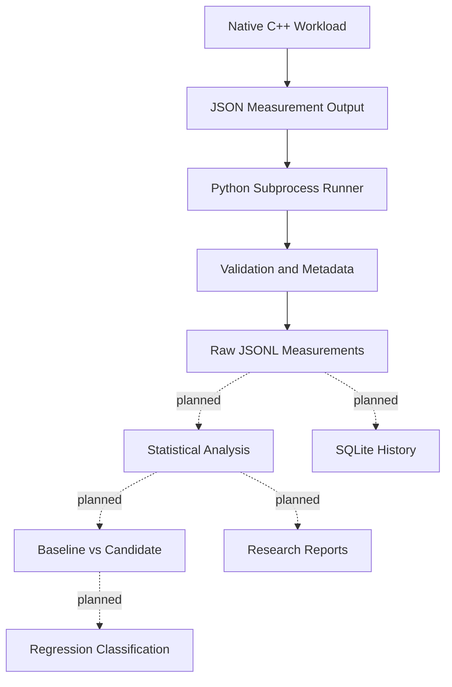

# BenchForge
### Systems Performance & Reliability Benchmarking Toolkit

**Can we reliably detect a real performance regression on a noisy machine — and how many measurements do we need?**

BenchForge is an experimental systems-performance research toolkit designed to investigate performance regressions through repeatable workloads, raw measurement collection, statistical analysis, and controlled experiments.

The project combines a native C++ benchmark workload with a Python orchestration layer. Its long-term objective is to evaluate not only whether a program became slower, but also whether the observed difference is statistically credible, reproducible, and distinguishable from normal machine noise.

> **Project status:** Early implementation and integration testing. The native hash-lookup workload builds and executes successfully, and the Python runner has saved and validated a 10-sample measurement run. Statistical regression detection and real-world dataset validation are still under development.

---

## Table of Contents

- [Project Overview](#project-overview)
- [Demo and Video Walkthroughs](#demo-and-video-walkthroughs)
- [Why BenchForge?](#why-benchforge)
- [Architecture](#architecture)
- [Current Capabilities](#current-capabilities)
- [Research Questions](#research-questions)
- [Real-World Data and Validation Strategy](#real-world-data-and-validation-strategy)
- [Technology Stack](#technology-stack)
- [Getting Started](#getting-started)
- [Running a Benchmark](#running-a-benchmark)
- [Measurement Format](#measurement-format)
- [Experimental Roadmap](#experimental-roadmap)
- [Reliability and Limitations](#reliability-and-limitations)
- [Repository Structure](#repository-structure)
- [Testing](#testing)
- [Future Work](#future-work)
- [References](#references)

---

## Project Overview

Traditional benchmarking often compares a single timing result against another. On real machines, however, timing measurements are affected by operating-system scheduling, background processes, CPU frequency changes, thermal conditions, cache state, and other sources of variability.

A small timing difference does not automatically mean that a regression occurred.

BenchForge aims to build an experimental framework for answering four questions:

1. **Detection:** Can an actual performance regression be distinguished from normal variation?
2. **Statistical reliability:** How often does the detection method raise a false alarm when no regression exists?
3. **Sample efficiency:** How many measurements are required to detect slowdowns of different magnitudes?
4. **Robustness:** How does detection performance change under different levels of background noise?

The current implementation begins with a native C++ hash-map lookup workload. The planned framework will extend this foundation into repeatable experiments and evidence-based performance comparisons.

## Demo and Video Walkthroughs

Short demonstrations will document the complete workflow, from compiling the native workload to inspecting measurements and evaluating regression-detection results.

**Demo 1 — Project setup and architecture**

*Planned recording:* repository structure, Python environment, CMake configuration, and native compilation.

**Demo 2 — Executing a benchmark**

*Planned recording:* running the native executable through the Python CLI, collecting repeated measurements, and inspecting the generated JSONL file.

**Demo 3 — Statistical comparison**

*Planned recording:* baseline-versus-candidate comparison, uncertainty intervals, and regression classification after the comparison workflow is implemented and validated.

**Demo 4 — Real-world benchmark evaluation**

*Planned recording:* importing a suitable public benchmark dataset, running the evaluation pipeline, and presenting reproducible results.

> Replace these planned demonstrations with actual recordings as the corresponding workflows become available. Do not present a planned feature as an implemented capability.

Suggested repository media layout:

```text
docs/
└── media/
    ├── architecture.png
    ├── benchmark-workflow.gif
    ├── benchmark-execution.mp4
    └── regression-analysis.gif
```

GitHub README support for video embeds can vary by media-hosting method. A practical approach is to display a short, optimized GIF directly in the README and link to the full video hosted in the repository, a GitHub release, or another accessible video location.

Example, once the GIF exists:

```markdown

```

---

## Why BenchForge?

A useful benchmarking system should do more than produce elapsed times. It should preserve measurements, expose uncertainty, and evaluate its own error rates.

BenchForge is being developed around the following principles:

| Principle | Objective |
|---|---|
| Reproducibility | Preserve raw samples and execution metadata. |
| Statistical validity | Evaluate uncertainty instead of relying on one timing result. |
| Controlled experiments | Introduce known workload changes to measure detection behavior. |
| Sample efficiency | Determine the measurement budget needed for reliable decisions. |
| Transparency | Distinguish observed results from statistical conclusions. |
| Extensibility | Add workloads, data sources, and analysis methods without redesigning the entire system. |

The central research question is not simply whether a benchmark runs faster or slower. It is whether the evidence is strong enough to justify that conclusion.

---

## Architecture

The current implementation has a native workload and a Python orchestration layer. Statistical comparison, historical storage integration, and reporting remain development goals.



### Component responsibilities

**1. Native workload — C++20**

Executes a hash-map lookup workload and measures the elapsed duration with a monotonic clock. Workload setup occurs outside the timed region.

The executable emits one JSON measurement containing the workload identifier, iteration count, perturbation parameter, elapsed nanoseconds, and checksum.

**2. Python orchestration — Python**

Invokes the native executable through a subprocess, performs configurable warm-up executions, parses the JSON response, validates basic measurement properties, attaches environment metadata, and writes measured samples to JSONL.

**3. Statistical engine — planned**

Will evaluate baseline and candidate measurements using uncertainty intervals and statistical tests. The method must be calibrated and evaluated before its regression classifications can be treated as reliable.

**4. Historical storage — partially scaffolded**

An initial SQLite schema can be created through the CLI. Integration between the database and the benchmark execution pipeline remains future work.

**5. Reporting — planned**

Will turn validated measurements and experiment results into reproducible tables, visualizations, and summaries.

---

## Current Capabilities

The following reflects the project state verified during development, rather than the full planned scope.

| Capability | Status |
|---|---|
| C++20 compiler and native CMake configuration | Verified |
| Native hash-lookup executable | Builds and executes |
| Versioned JSON measurement output | Verified |
| Python subprocess-based runner | Implemented and exercised |
| Warm-up and measured-run separation | Implemented |
| JSONL raw measurement output | Verified |
| Basic timing summary: median, P95, minimum, maximum | Implemented |
| Existing Python test suite | 9 tests passing in the recorded run |
| Ten-sample integration run | Saved and validation passed |
| Baseline/candidate statistical comparison | Not implemented |
| Calibrated regression decisions | Not validated |
| SQLite history connected to benchmark runs | Pending |
| Automated report generation | Pending |
| Public real-world benchmark evaluation | Pending |

The initial integration run used 10 measured samples, 2 warm-up executions, and 100,000 lookup iterations per measured execution.

The reported median was approximately 2.18 million nanoseconds for that run. This is a local observation, not a stable performance baseline or a validated regression result. Timing will vary with the execution environment.

---

## Research Questions

### RQ1 — False-positive calibration

When the baseline and candidate represent the same underlying performance, how frequently does the detector incorrectly report a regression?

An A/A experiment will compare two equivalent configurations to estimate the false-positive rate.

### RQ2 — Detection sensitivity

Can the framework detect injected slowdowns of 2%, 5%, 10%, and 20%?

The slowdown must be independently verified rather than inferred solely from the workload parameter.

### RQ3 — Sample efficiency

How does detection power change as the number of measured samples increases?

The study will compare multiple sample budgets and report uncertainty around the estimated detection rate.

### RQ4 — Statistical method comparison

How do a simple threshold, a conventional statistical test, and the proposed decision procedure compare in false-positive rate, detection power, and sample requirements?

### RQ5 — Environmental noise

How does background load or other environmental variation affect the reliability of regression detection?

Experiments will document the conditions under which the detector becomes inconclusive or unreliable.

---

## Real-World Data and Validation Strategy

Controlled experiments are necessary, but they are not sufficient. A useful evaluation should also examine performance results produced by established benchmark projects.

### Candidate public sources

**1. [Airspeed Velocity (ASV)](https://github.com/airspeed-velocity/asv)**

ASV is a benchmark suite management tool designed to track performance over project revisions. Its documented results format includes benchmark results and sample-related information.

Potential use:
- Study historical benchmark changes across commits.
- Identify candidate performance regressions for further investigation.
- Evaluate how BenchForge's analysis behaves on previously recorded benchmark data.

Important limitation: historical observations do not automatically establish that a change was a genuine regression. Hardware changes, environment differences, benchmark changes, and measurement uncertainty must be considered.

**2. [Python Performance Benchmark Suite](https://github.com/python/pyperformance)**

`pyperformance` focuses on real-world Python performance benchmarks, including workloads involving serialization, numerical operations, and application-level behavior.

Potential use:
- Select representative workloads for a separate evaluation harness.
- Compare implementations or revisions where measurements are compatible.
- Investigate whether conclusions from controlled experiments generalize to more realistic workloads.

Important limitation: BenchForge currently executes its own native C++ workload. Direct ingestion or execution of `pyperformance` and ASV results is not yet implemented.

### Proposed evaluation pipeline

```text
Public benchmark source
        |
        v
Dataset inspection and license review
        |
        v
Select comparable benchmark observations
        |
        v
Normalize metadata and measurement units
        |
        v
Identify valid baseline/candidate pairs
        |
        v
Run the evaluation and analysis pipeline
        |
        v
Report limitations, uncertainty, and results
```

The evaluation should preserve source provenance, project revision, machine and environment metadata where available, measurement units, and any filtering decisions.

**A key distinction:** evaluating historical timing data tests analytical behavior; rerunning the benchmark tests execution and measurement behavior. Both are useful, but they answer different questions.

---

## Technology Stack

| Layer | Technology | Purpose |
|---|---|---|
| Native benchmark | C++20 | Execute the timed workload |
| Build system | CMake | Configure the native project |
| Build backend | Ninja | Build native targets |
| Orchestration | Python | Control benchmark execution |
| Process interface | Python `subprocess` | Invoke the native executable |
| Measurement interchange | JSON / JSONL | Preserve structured measurements |
| Numerical analysis | NumPy, SciPy | Planned statistical calculations |
| Visualization | Matplotlib | Planned research plots |
| CLI | Typer, Rich | Command-line interface and summaries |
| Historical storage | SQLite | Initial local-history schema |
| Testing | pytest | Automated verification |
| Quality tooling | Ruff | Python linting and code-quality checks |
| Change-point analysis | ruptures | Candidate tool for later experiments |

The presence of a dependency does not imply that every planned feature using it is implemented.

---

## Getting Started

### Prerequisites

The current development environment uses Windows PowerShell, Python, CMake, Ninja, and an available C++20-capable compiler.

You will need:

- Python with a supported version for the project configuration.
- A C++20-capable compiler.
- CMake 3.20 or newer.
- Ninja, if using the Ninja build generator.
- Git.

### 1. Clone the repository

```powershell
git clone https://github.com/gavneet0030/BenchForge.git
Set-Location .\BenchForge
```

### 2. Create and activate a virtual environment

```powershell
py -m venv .venv
.\.venv\Scripts\Activate.ps1
```

If PowerShell blocks activation, use an approved local execution-policy approach or invoke the environment's Python executable directly.

### 3. Install the project

```powershell
python -m pip install --upgrade pip
python -m pip install -e ".[dev]"
```

The exact optional dependency group must match the repository's `pyproject.toml`.

### 4. Configure the native workload

For a Windows environment with the MSYS2 UCRT64 compiler and Ninja installed:

```powershell
$env:PATH = "C:\msys64\ucrt64\bin;$env:PATH"

cmake -S .\native -B .\build\native-ucrt64 -G Ninja `
    -DCMAKE_BUILD_TYPE=Release `
    -DCMAKE_CXX_COMPILER="C:/msys64/ucrt64/bin/g++.exe"
```

### 5. Build the executable

```powershell
cmake --build .\build\native-ucrt64 --verbose
```

The executable is expected at:

```text
build/native-ucrt64/benchforge_lookup.exe
```

Compiler paths are machine-specific. Update the configuration for your own environment rather than assuming that the example path exists on every system.

---

## Running a Benchmark

Run the native executable directly:

```powershell
.\build\native-ucrt64\benchforge_lookup.exe `
    --iterations 100000 `
    --extra-work 0
```

The current executable emits a single JSON object containing a measurement.

To collect repeated samples through the Python runner:

```powershell
benchforge run `
    --binary ".\build\native-ucrt64\benchforge_lookup.exe" `
    --runs 30 `
    --warmup 3 `
    --iterations 100000 `
    --extra-work 0 `
    --output ".\data\raw\latest.jsonl"
```

The command runs warm-up executions, retains the measured samples, prints a basic timing summary, and writes the raw measurements to the requested JSONL file.

The output path can be changed to preserve separate experiment runs.

### Interpreting the output

- **Median:** the middle observed timing and a useful summary for skewed measurements.
- **P95:** the 95th percentile of the observed durations, which can reflect the slower tail of the sample distribution.
- **Minimum and maximum:** the observed extremes, not guaranteed bounds on future performance.

These descriptive statistics do not, by themselves, establish that a candidate is faster or slower than a baseline.

---

## Measurement Format

The native executable currently emits a versioned measurement similar to:

```json
{
  "schema_version": 1,
  "workload": "hash_lookup",
  "iterations": 100000,
  "extra_work": 0,
  "elapsed_ns": 2800900,
  "checksum": 8499450000
}
```

The Python runner adds metadata to measured records, including:

- UTC timestamp
- Sample index
- Number of warm-up runs
- Operating-system/platform description
- Python version
- Executable name

Records are serialized as newline-delimited JSON. Each line represents one measured run.

The example timing is illustrative of an observed local run, not a performance guarantee.

---

## Experimental Roadmap

| Experiment | Purpose | Status |
|---|---|---|
| E1 — A/A calibration | Estimate false-positive rate | Planned |
| E2 — Controlled slowdowns | Measure sensitivity to known changes | Planned |
| E3 — Sample-size study | Estimate detection power at different budgets | Planned |
| E4 — Method comparison | Compare candidate statistical procedures | Planned |
| E5 — Background noise | Evaluate environmental robustness | Planned |
| E6 — Historical benchmark case study | Evaluate selected public benchmark results | Planned |

The experimental results should report sample counts, decision criteria, uncertainty, and failure cases. A successful demonstration on a small number of runs should not be treated as sufficient evidence of statistical reliability.

---

## Reliability and Limitations

BenchForge is a research project under active development. The current version is not a production regression-monitoring system.

Known limitations include:

- Only the native hash-map lookup workload is currently established.
- The `extra_work` parameter is a workload perturbation control, not a calibrated percentage slowdown.
- The runner validates basic output properties, but its test suite needs stronger end-to-end and failure-path coverage.
- Baseline/candidate comparison and calibrated regression classification are not yet implemented.
- Historical database persistence is not yet connected to the full run workflow.
- Public benchmark datasets have not yet been integrated into the project.
- Results collected on one machine may not generalize to other machines or environments.

A mature version should include repeated trials, environment metadata, workload validation, controlled experiments, automated statistical tests, and documented limitations.

---

## Repository Structure

```text
BenchForge/
├── .github/
│   └── workflows/
├── data/
│   ├── raw/
│   └── processed/
├── docs/
│   └── media/
├── experiments/
│   ├── simulation/
│   ├── hardware/
│   └── README.md
├── native/
│   ├── CMakeLists.txt
│   ├── include/
│   ├── src/
│   │   └── lookup.cpp
│   └── tests/
├── reports/
│   └── generated/
├── scripts/
├── src/
│   └── benchforge/
│       ├── __init__.py
│       ├── cli.py
│       ├── runner.py
│       └── stats.py
├── tests/
│   ├── fixtures/
│   ├── integration/
│   └── unit/
├── workloads/
│   └── hash_lookup.json
├── .gitignore
├── pyproject.toml
└── README.md
```

Some directories are placeholders for future work; the tree describes the intended project organization rather than claiming that every component is complete.

---

## Testing

Run the current test suite:

```powershell
pytest tests -q
```

The recorded development run completed with:

```text
9 passed
```

A separate native/Python integration run successfully collected and validated 10 measured samples, each using 100,000 iterations. These are development verification results, not a claim that all future configurations or environments are tested.

Future tests should cover:

- Invalid native arguments and non-zero exit codes.
- Malformed or unsupported measurement schemas.
- Missing executables and subprocess timeouts.
- JSONL persistence and record consistency.
- Statistical calibration under A/A experiments.
- Detection power under controlled slowdowns.
- Reproducibility across repeated experiments.

---

## Future Work

The planned development sequence is:

1. Strengthen native/Python integration tests.
2. Define and validate a stable measurement contract.
3. Implement baseline/candidate comparison and statistical decision logic.
4. Add controlled slowdown experiments and A/A calibration.
5. Integrate benchmark history with SQLite.
6. Add reproducible reports and research visualizations.
7. Evaluate selected public benchmark data.
8. Document end-to-end demonstrations and reproducible results.
9. Improve CI coverage, packaging, error handling, and release readiness.

The priority is to validate the measurement and statistical methodology before presenting BenchForge as a reliable regression detector.

---

## References

- [BenchForge repository](https://github.com/gavneet0030/BenchForge)
- [Airspeed Velocity — benchmark suite management](https://github.com/airspeed-velocity/asv)
- [Python Performance Benchmark Suite](https://github.com/python/pyperformance)
- [pyperf — Python benchmarking toolkit](https://github.com/psf/pyperf)

---

## Project Philosophy

**Measure first. Quantify uncertainty. Validate the detector. Then trust the conclusion.**

BenchForge is being built to make performance-regression analysis more reproducible, statistically defensible, and transparent about what the evidence does — and does not — establish.
