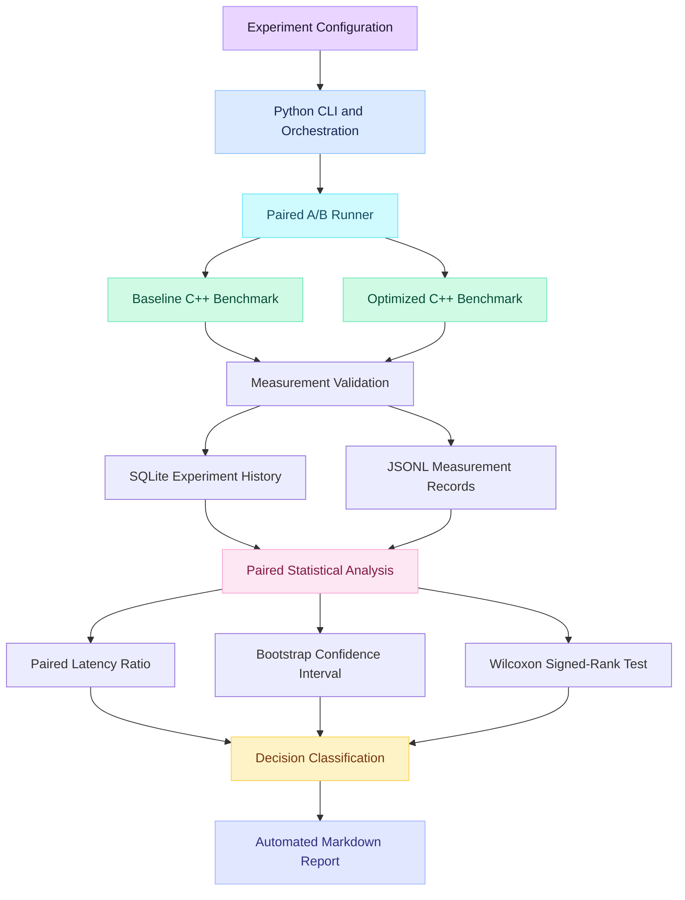

<div align="center">

# BenchForge

### Systems Performance · Reliability · Experimental Engineering

**Measure performance. Quantify uncertainty. Make evidence-based decisions.**

<p>
  <a href="https://github.com/gavneet0030/BenchForge">
    
  </a>
  
  
  
  
</p>

*A reproducible benchmarking toolkit for investigating performance changes, measurement noise, and statistical evidence.*

[Overview](#-the-project) ·
[Results](#-experimental-results) ·
[Architecture](#-system-architecture) ·
[Installation](#-installation) ·
[Demo](#-demo) ·
[Research](#-experimental-methodology)

</div>

---

## 🔎 The project

### The real-world problem

Performance optimization is a common task in systems engineering. Developers change algorithms, remove expensive operations, improve memory access patterns, and tune native code to reduce latency.

But an optimization that appears faster in one measurement may not actually be faster.

Measurements can be affected by:

- CPU scheduling and background processes.
- Warm-up effects and runtime state.
- Compiler optimizations and build configuration.
- Workload characteristics and input distribution.
- Hardware, thermal conditions, and frequency scaling.
- Natural variation between repeated executions.

A single timing result cannot reliably distinguish a genuine improvement from measurement noise.

**The engineering question:** How can we compare two implementations, quantify uncertainty, and make a defensible decision about the observed performance difference?

### The solution

BenchForge is an experimental systems-performance toolkit that combines native C++ benchmarks with Python orchestration, persistent measurement storage, paired statistical analysis, and automated reporting.

Instead of relying on one timing or a simple average, BenchForge supports repeated baseline-versus-candidate experiments and evaluates their results using paired measurements, bootstrap confidence intervals, and a Wilcoxon signed-rank test.

The outcome is a reproducible experiment record and a Markdown report that explains what was measured, what the data supports, and what limitations remain.

### At a glance

| Dimension | Current implementation |
|---|---|
| Primary domain | Systems performance and reliability benchmarking |
| Demonstrated workload | Native C++ hash-map lookup |
| Optimization investigated | Lookup-key generation without modulo in the measured loop |
| Experiment design | Repeated paired A/B measurements |
| Native language | C++20 |
| Orchestration and analysis | Python |
| Persistence | SQLite |
| Raw measurements | JSONL |
| Statistical analysis | Paired median ratio, bootstrap CI, Wilcoxon signed-rank test |
| Report output | Markdown |
| Build system | CMake and Ninja |
| Verification | pytest, Ruff, CTest |

---

## 🎯 Why BenchForge matters

A performance benchmark should do more than print elapsed time.

It should help answer five questions:

1. **Correctness:** Do both implementations produce the expected result?
2. **Measurement:** Were enough observations collected to inspect variation?
3. **Effect size:** How much did the measured latency change?
4. **Uncertainty:** How precise is the estimated performance difference?
5. **Decision:** Does the evidence satisfy the configured decision criteria?

BenchForge brings these concerns into one workflow.

The current implementation is a focused research prototype, not a universal performance-monitoring platform. Its demonstrated results apply to the tested workload and environment.

## 🧪 Experimental results

### Case study: optimizing native hash-map lookup

The current experiment compares a baseline C++ implementation with an optimized candidate that replaces modulo-based lookup-key progression with increment-and-wrap logic.

Both implementations are checked for correctness before their timing results are compared.

### Replicated results

Two independent experiments were performed on the same Windows machine and workload configuration.

| Metric | Experiment 1 | Experiment 2 |
|---|---:|---:|
| Paired observations | 30 | 30 |
| Warm-up runs per variant | 3 | 3 |
| Iterations per sample | 1,000,000 | 1,000,000 |
| Baseline median | 16.8019 ms | 16.7362 ms |
| Candidate median | 15.12095 ms | 15.0298 ms |
| Relative median change | -10.00% | -10.15% |
| Paired bootstrap 95% CI | [0.87662, 0.90477] | [0.89283, 0.90667] |
| Wilcoxon p-value | 0.0001374 | 0.000001684 |
| Configured decision | PASS | PASS |

*The confidence intervals are for the paired latency ratio. A ratio below 1.0 indicates lower candidate latency.*

### What did the experiment yield?

**Observed outcome:** The candidate's median latency was approximately 10% lower in both experiments.

The paired bootstrap confidence intervals were below 1.0, and both Wilcoxon signed-rank tests returned p-values below 0.05. Under the configured 3% regression threshold, both comparisons were classified as `PASS`.

This is encouraging evidence for the specific implementation, machine, compiler configuration, and workload tested.

It is not proof of a universal 10% improvement. A different processor, compiler, workload, or execution environment may produce a different result. Further validation across machines and workloads is needed before making broader claims.

### Reproducibility

The replication experiment used:

- 30 measured observations per variant.
- 3 warm-up runs per variant.
- 1,000,000 iterations per measured sample.
- Experiment seed `20261025`.
- Bootstrap confidence level of 95%.
- 5,000 bootstrap resamples for the generated report.
- A configured regression threshold of 3%.
- A significance level of 0.05.

**Replication run ID**

`c479d611-d75d-4c98-9a3b-713a9439bfee`

The stored run can be used to regenerate the corresponding report when the experiment database is available.

---

## 🏗️ System architecture

BenchForge separates the native benchmark from experiment control, persistence, statistical analysis, and reporting.



### Architecture components

| Component | Responsibility |
|---|---|
| Python CLI | Exposes benchmark, comparison, reporting, and diagnostic commands |
| A/B runner | Coordinates repeated baseline and candidate executions |
| Native C++ executables | Execute the workload and emit benchmark measurements |
| Runtime environment helper | Prepares the child-process environment for native execution on Windows |
| Measurement validation | Checks benchmark output and relevant data constraints |
| JSONL | Retains raw experiment observations |
| SQLite | Stores benchmark history for later comparison and report generation |
| Statistical module | Calculates ratios, confidence intervals, tests, and classifications |
| Report generator | Produces a human-readable summary of the stored experiment |

---

## 🔄 End-to-end workflow


1. **Configure:** Select the workload, iteration count, repetitions, warm-ups, and experiment parameters.
2. **Build:** Compile the native baseline and candidate implementations.
3. **Check correctness:** Verify that both executables return valid results and matching checksums.
4. **Warm up:** Execute the configured warm-up runs before collecting measured samples.
5. **Measure:** Run the baseline and candidate repeatedly under the experiment configuration.
6. **Validate:** Reject malformed or invalid measurement records according to the runner's validation rules.
7. **Persist:** Retain raw JSONL observations and store benchmark records in SQLite.
8. **Analyze:** Compute paired performance statistics and uncertainty estimates.
9. **Classify:** Apply the configured decision criteria.
10. **Report:** Generate a Markdown report with results, provenance, and limitations.

---

## 📐 Experimental methodology

### 1. Paired performance comparison

The analysis preserves the relationship between corresponding baseline and candidate observations.

For a paired observation \(i\), define the latency ratio as

\[
r_i = \frac{T_{\mathrm{candidate},i}}
           {T_{\mathrm{baseline},i}}
\]

where \(T\) represents measured elapsed time.

The paired median ratio is estimated using the median of the log-transformed paired ratios:

\[
R = \exp\left(\operatorname{median}
\left(\log r_i\right)\right)
\]

Interpretation:

- \(R < 1\): the candidate has lower latency.
- \(R = 1\): the estimated paired ratio is 1.
- \(R > 1\): the candidate has higher latency.

The relative change in latency is reported as

\[
100(R-1)\%
\]

Negative values indicate lower candidate latency.

### 2. Bootstrap confidence interval

BenchForge uses paired bootstrap resampling to estimate a confidence interval for the latency ratio.

The analysis resamples paired observations together, preserving each baseline/candidate relationship. The resulting interval communicates uncertainty in the estimated ratio under the resampling procedure.

### 3. Wilcoxon signed-rank test

The paired Wilcoxon signed-rank test evaluates evidence of a systematic difference between paired measurements.

Its p-value is interpreted alongside the estimated effect size, confidence interval, sample count, and experimental design. A small p-value alone does not establish that an improvement is practically important.

### 4. Decision classification

The report generator supports three classifications:

| Decision | Meaning |
|---|---|
| `PASS` | The confidence interval satisfies the configured non-regression criterion |
| `REGRESSION` | The estimated interval exceeds the configured regression threshold and the statistical test satisfies the configured significance criterion |
| `INCONCLUSIVE` | The evidence does not satisfy either decision rule |

The threshold and significance level are configurable. `PASS` does not prove equivalence, and `INCONCLUSIVE` does not prove that the implementations are equal.

---

## 🗃️ Data and provenance

### What data does BenchForge use?

The demonstrated benchmark uses a controlled native hash-map lookup workload with generated lookup inputs and a deterministic checksum check.

**This project does not currently depend on an external business dataset or a Kaggle dataset for its demonstrated performance experiment.** The primary data consists of benchmark measurements produced by running the baseline and candidate executables.

### Data flow

| Data artifact | Purpose |
|---|---|
| Generated lookup inputs | Drive the controlled benchmark workload |
| Native JSON output | Carries measurement results and checksum information |
| JSONL experiment records | Preserve raw observations for inspection |
| SQLite database | Stores benchmark samples and experiment history |
| Run configuration | Captures relevant workload and experiment parameters |
| Markdown report | Summarizes results, uncertainty, statistical tests, and limitations |

### Why retain raw measurements?

Raw measurements make it possible to investigate variability, inspect individual observations, reproduce statistical analysis, and distinguish experimental data from conclusions derived from it.

A summary statistic without its underlying observations and configuration is less useful for independent review.

### Example experiment record

A simplified conceptual measurement record might contain:

```json
{
  "variant": "baseline",
  "workload": "hash_lookup",
  "iterations": 1000000,
  "elapsed_ns": 16800000,
  "checksum": 8494500
}
```

This is an illustrative example of the measurement fields, not a claim that it is an exact stored JSONL row. The actual record schema and required fields are defined by the implementation.

---

## 🧰 Technology stack and why each tool is used

| Technology | Role in BenchForge | Why it is used |
|---|---|---|
| **C++20** | Native benchmark implementation | Executes low-level workloads with direct control over the code being measured |
| **Python** | Experiment orchestration | Coordinates runs, validation, analysis, and report generation |
| **CMake** | Native build configuration | Defines targets and integrates native tests |
| **Ninja** | Build execution | Provides an efficient incremental native build workflow |
| **NumPy** | Numerical computation | Supports array and numerical operations used in analysis |
| **SciPy** | Statistical testing | Provides the paired Wilcoxon signed-rank test |
| **SQLite** | Experiment persistence | Stores measurements for later comparisons and reports |
| **JSONL** | Raw data storage | Keeps observations in a portable line-oriented format |
| **pytest** | Python verification | Tests CLI behavior, validation, statistics, and runner functionality |
| **Ruff** | Python linting | Checks code quality and common Python issues |
| **CTest** | Native verification | Runs automated baseline and optimized executable correctness tests |
| **Git and GitHub** | Version control | Track changes and publish the research implementation |

---

## Demo
**Demo video:** A recorded demonstration link has not yet been added.

The intended demo should show the following workflow:

1. Build the baseline and optimized native executables.
2. Run a paired A/B benchmark.
3. Inspect the generated measurement records.
4. Run statistical comparison and inspect the decision.
5. Generate and open the Markdown experiment report.
6. Re-run the report from a stored experiment ID.

To add your recording, replace the placeholder below with a public video URL.

**Recording status:** An end-to-end demo video has not been published yet.

The planned walkthrough will demonstrate native builds, paired A/B execution, statistical comparison, and automated report generation.

> A public demo link will be added here when the recording is available.

Recommended recording: a short terminal walkthrough followed by the generated report. Show the commands, the final decision, the confidence interval, and the limitations section rather than only displaying a performance percentage.

---

## Installation
### Prerequisites

The verified development environment uses:

- Windows
- Python 3.14
- A C++20-capable compiler
- CMake
- Ninja
- Git

The current native build was verified using the MSYS2 UCRT64 toolchain. Other operating systems and compilers require separate validation.

### Step 1

```powershell
git clone https://github.com/gavneet0030/BenchForge.git
cd BenchForge
```

### Step 2

```powershell
py -m venv .venv
.\.venv\Scripts\python.exe -m pip install --upgrade pip
```

### Step 3

Install the project and development dependencies:

```powershell
.\.venv\Scripts\python.exe -m pip install -e ".[dev]"
```

For a runtime-only installation without development dependencies:

```powershell
.\.venv\Scripts\python.exe -m pip install -e .
```

### Step 4

Configure the native C++20 targets with CMake and Ninja:

```powershell
cmake -S native -B build/native-ucrt64 -G Ninja -DCMAKE_CXX_COMPILER=C:/msys64/ucrt64/bin/g++.exe -DCMAKE_BUILD_TYPE=Release
```

Build both baseline and optimized executables:

```powershell
cmake --build build/native-ucrt64 --config Release
```

Run native correctness tests:

```powershell
ctest --test-dir build/native-ucrt64 -C Release --output-on-failure
```

Prerequisites: CMake, Ninja, and a working C++20 compiler. The compiler path above matches the verified MSYS2 UCRT64 environment; adjust it if your installation differs.

### Step 5

```powershell
.\.venv\Scripts\python.exe -m benchforge.cli --help
```

Inspect available command options:

```powershell
.\.venv\Scripts\python.exe -m benchforge.cli doctor --help
.\.venv\Scripts\python.exe -m benchforge.cli run --help
.\.venv\Scripts\python.exe -m benchforge.cli ab --help
.\.venv\Scripts\python.exe -m benchforge.cli compare --help
.\.venv\Scripts\python.exe -m benchforge.cli report --help
```

Use the help output from your checkout as the source of truth for supported arguments.

---

## 📊 Reproducing the stored replication report

The following command regenerates the report for the verified replication run, assuming its SQLite database is available locally.

```powershell
.\.venv\Scripts\python.exe -m benchforge.cli report `
  --run-id "c479d611-d75d-4c98-9a3b-713a9439bfee" `
  --database "data/benchforge.sqlite" `
  --output "reports/generated/lookup-optimization-replication.md" `
  --threshold 0.03 `
  --confidence 0.95 `
  --n-resamples 5000 `
  --seed 2026 `
  --alpha 0.05 `
  --force
```

**Important:** The command reproduces the report from stored measurements; it does not rerun the original benchmark. The database and associated experiment records must be available.

The `--force` option permits overwriting the output report. Use it only when you intend to replace the existing file.

---

## ✅ Testing and quality gates

The verified development revision passed these checks:

| Check | Verified outcome |
|---|---|
| Python test suite | 90 passed |
| Ruff | All checks passed |
| Native C++ build | Passed; build was up to date |
| Native CTest | 2 of 2 passed |
| Git staged-patch check | Passed |

These are results from the verified development revision, not a guarantee that every future checkout or toolchain will produce identical results.

Run the Python test suite:

```powershell
.\.venv\Scripts\python.exe -m pytest -q
```

Run lint:

```powershell
.\.venv\Scripts\python.exe -m ruff check src tests
```

Run native tests:

```powershell
ctest --test-dir build/native-ucrt64 -C Release --output-on-failure
```

---

## Repository Structure
```text
BenchForge/
|-- .github/
|   `-- workflows/
|-- docs/
|   `-- RESEARCH_PLAN.md
|-- native/
|   |-- src/
|   |   |-- lookup.cpp
|   |   `-- lookup_optimized.cpp
|   |-- tests/
|   |   `-- test_lookup.cmake
|   `-- CMakeLists.txt
|-- src/
|   `-- benchforge/
|       |-- ab.py
|       |-- cli.py
|       |-- runner.py
|       `-- stats.py
|-- tests/
|   `-- unit/
|-- data/
|-- experiments/
|-- reports/
|   `-- generated/
|-- README.md
`-- pyproject.toml
```

Directory contents can vary between local and fresh repository checkouts; generated data and build artifacts may be excluded from version control.

---

## Limitations and Research Integrity
BenchForge is an active research and development project. Its current evidence has specific boundaries:

- The demonstrated benchmark is a hash-map lookup microbenchmark, not a representative suite of all systems workloads.
- The reported experiments were run on one machine.
- Statistical tests do not remove systematic measurement bias or guarantee sound experimental design.
- CPU state, compiler configuration, workload selection, and background processes can influence results.
- The configured decision threshold is an engineering policy, not a universal definition of a regression.
- The current results do not establish cross-platform performance.
- Broader workload coverage, environmental quality gates, and validation across multiple machines remain future work.

The objective is not to make every benchmark result look positive. It is to make the evidence, assumptions, uncertainty, and limitations explicit.

---

## Roadmap
- [x] Native baseline hash-map lookup benchmark
- [x] Optimized candidate implementation
- [x] Baseline and candidate correctness checks
- [x] Python benchmark orchestration
- [x] SQLite-backed benchmark history
- [x] Paired statistical comparison
- [x] Bootstrap confidence intervals
- [x] Wilcoxon signed-rank test
- [x] Configurable decision classification
- [x] Automated Markdown report generation
- [ ] Additional representative workload families
- [ ] Broader compiler and machine validation
- [ ] Stronger environmental noise diagnostics
- [ ] Sample-size sensitivity studies
- [ ] Expanded continuous-integration coverage
- [ ] Recorded end-to-end demo
- [ ] Additional report visualizations

---

## 🤝 Engineering principles

BenchForge is guided by a few principles:

- **Reproducibility:** Retain configuration and raw observations.
- **Correctness first:** Validate results before interpreting timings.
- **Statistical transparency:** Report effect sizes, uncertainty, and test outcomes.
- **Honest conclusions:** Separate measured outcomes from general claims.
- **Explicit limitations:** Document where evidence does and does not apply.
- **Maintainability:** Keep the native workload, orchestration, statistics, and reporting responsibilities distinct.

## 📄 License

See the repository's `LICENSE` file for the applicable license terms.

---

<div align="center">

### Measure carefully. Quantify uncertainty. Engineer with evidence.

**BenchForge — Experimental performance engineering, made reproducible.**

</div>
