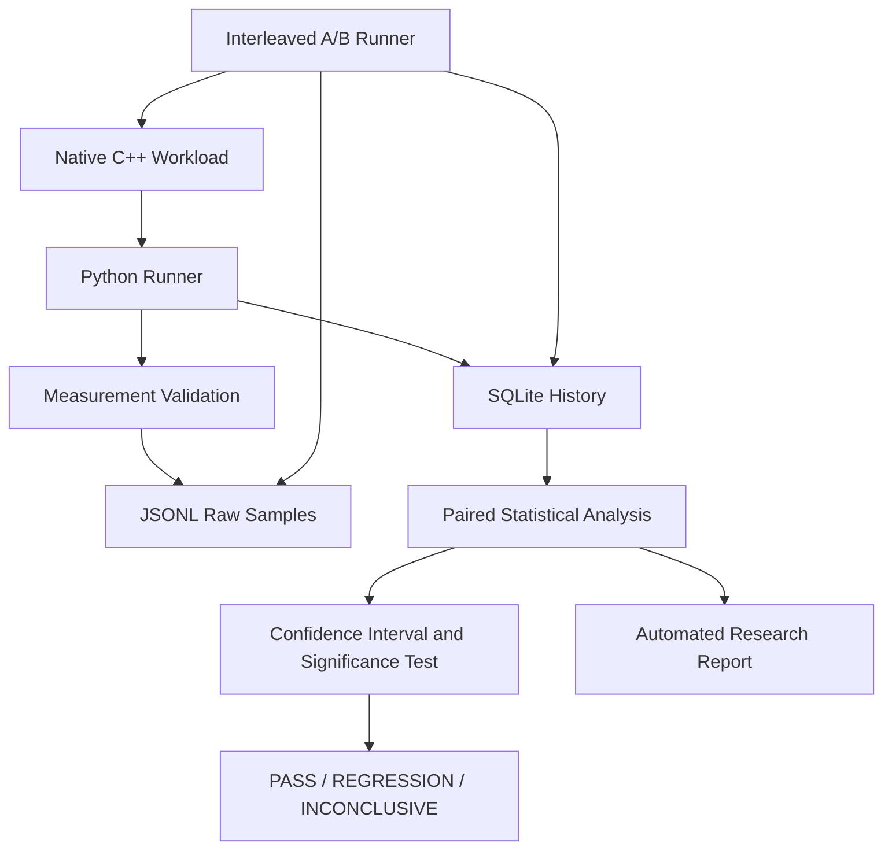

# BenchForge

### Systems Performance & Reliability Benchmarking Toolkit

**Can we reliably detect a real performance regression on a noisy machine — and how many measurements do we need?**

BenchForge is an experimental systems-performance research toolkit for investigating performance regressions through native workloads, repeated measurements, statistical analysis, and controlled experiments.

It combines a native C++ hash-map lookup benchmark with Python orchestration, JSONL measurement output, paired A/B experiments, statistical comparisons, and SQLite-backed benchmark history.

> **Project status:** Active research and development. The core benchmark, A/B execution, persistence, statistical comparison, and automated Markdown report workflow are implemented. Environmental quality gates, additional workloads, and broader validation remain future work.

## Table of Contents

- [Project Overview](#project-overview)
- [Why BenchForge?](#why-benchforge)
- [Architecture](#architecture)
- [Current Capabilities](#current-capabilities)
- [Statistical Methodology](#statistical-methodology)
- [Research Questions](#research-questions)
- [Technology Stack](#technology-stack)
- [Getting Started](#getting-started)
- [Running Benchmarks](#running-benchmarks)
- [Running an A/B Comparison](#running-an-ab-comparison)
- [SQLite Benchmark History](#sqlite-benchmark-history)
- [Measurement Format](#measurement-format)
- [Testing and Validation](#testing-and-validation)
- [Research Roadmap](#research-roadmap)
- [Reliability and Limitations](#reliability-and-limitations)
- [Repository Structure](#repository-structure)
- [Future Work](#future-work)

## Project Overview

Benchmark timings naturally vary with operating-system scheduling, background processes, CPU frequency, thermal conditions, cache state, and other environmental effects. A small timing difference alone does not establish a performance regression.

BenchForge investigates how to distinguish meaningful slowdowns from ordinary measurement variation, while preserving raw measurements and making uncertainty explicit.

The initial workload is a native C++ hash-map lookup benchmark. Python coordinates execution, records results, persists experiment history, and exposes analysis through a command-line interface.

## Why BenchForge?

- Repeated measurements instead of one-shot timing.
- Interleaved baseline/candidate execution to reduce some time-order effects.
- Raw JSONL measurement output.
- SQLite-backed experiment history.
- Paired bootstrap confidence intervals and a paired significance test.
- Explicit `PASS`, `REGRESSION`, and `INCONCLUSIVE` outcomes.
- Configurable workload parameters and random seeds.
- Automated Python and native-integration tests.

These capabilities provide an experimental foundation; they do not establish that every workload or machine has been fully calibrated.

## Architecture



## Current Capabilities

| Component | Current role |
|---|---|
| Native C++ workload | Executes the hash-map lookup benchmark |
| Python runner | Launches the native executable and collects measurements |
| A/B runner | Interleaves baseline and candidate measurements |
| JSONL output | Preserves raw benchmark records |
| SQLite storage | Stores samples and experiment history |
| Statistical analysis | Calculates paired bootstrap confidence intervals and a paired significance test |
| CLI | Provides `doctor`, `run`, `init-db`, `ab`, `compare`, and `report` commands |

The `report` command generates a Markdown report for a stored A/B run, including paired statistics, experiment configuration, environment metadata, interpretation, and a reproducibility command.

## Statistical Methodology

BenchForge compares paired baseline and candidate measurements rather than relying only on a difference between two independent averages.

The comparison workflow includes:

- **Paired median ratio:** Describes the relative timing change between candidate and baseline.
- **Paired bootstrap confidence interval:** Estimates uncertainty in the paired median ratio.
- **Wilcoxon signed-rank test:** Provides a paired significance test.
- **Decision threshold:** Uses a configurable practical regression threshold, 3% by default.
- **Decision states:** Reports `REGRESSION`, `PASS`, or `INCONCLUSIVE`.

The current classifier uses both practical effect size and statistical evidence. A result may remain inconclusive when the evidence is insufficient; this is intentional and should not be treated as a failed experiment.

Statistical results depend on sample size, workload behavior, environmental stability, and the assumptions of the chosen methods. They require further calibration before being treated as a general-purpose performance-regression guarantee.

## Research Questions

1. **False positives:** How often does an A/A experiment report a regression when both variants use the same implementation?
2. **Detection power:** How does the probability of detecting a slowdown change with effect size and sample count?
3. **Method comparison:** How do simple thresholds and statistical methods compare under controlled slowdowns?
4. **Execution order:** How much do ordering and time-dependent drift influence paired measurements?
5. **Environmental effects:** How does running inside or outside containerized environments affect measurement stability?

These questions define the research direction; they are not claims that every experiment has already been completed.

## Technology Stack

- **C++20:** Native benchmark workload.
- **Python:** Benchmark orchestration, storage, statistical analysis, and CLI.
- **SQLite:** Persistent local experiment history.
- **JSON / JSONL:** Measurement exchange and raw sample records.
- **pytest:** Automated test suite.
- **CMake and Ninja:** Native build configuration.
- **MSYS2 UCRT64 toolchain on Windows:** Current native build environment.

The repository's actual dependency configuration remains the source of truth for exact Python package versions and platform support.

## Getting Started

### Prerequisites

- Windows with PowerShell.
- Python and the repository's virtual environment.
- A working C++20 compiler, CMake, and Ninja for rebuilding the native workload.
- The project's Python dependencies installed in the virtual environment.

Activate the existing environment:

```powershell
Set-Location "C:\Users\PC\source\BenchForge"
.\.venv\Scripts\Activate.ps1
```

Inspect the local environment and CLI commands:

```powershell
benchforge doctor
benchforge --help
```

If the `benchforge` command is unavailable, install the local project into the active environment using the repository's configured packaging workflow.

## Running Benchmarks

Run the native workload using the currently built UCRT64 executable:

```powershell
benchforge run --binary "build\native-ucrt64\benchforge_lookup.exe"
```

Specify a native executable and experiment parameters explicitly:

```powershell
benchforge run `
  --binary "build\native-ucrt64\benchforge_lookup.exe" `
  --runs 30 `
  --warmup 3 `
  --iterations 100000 `
  --output "data\raw\latest.jsonl" `
  --database "data\benchforge.sqlite"
```

The `run` command supports configurable run count, warmups, iteration count, extra work, JSONL output path, and SQLite database path. Confirm that the chosen executable exists before running the benchmark.

## Running an A/B Comparison

Run an interleaved baseline/candidate experiment:

```powershell
benchforge ab `
  --baseline-binary "build\native-ucrt64\benchforge_lookup.exe" `
  --candidate-binary "build\native-ucrt64\benchforge_lookup.exe" `
  --runs 30 `
  --warmup 3 `
  --iterations 100000 `
  --seed 2026 `
  --output "data\raw\latest-ab.jsonl" `
  --database "data\benchforge.sqlite"
```

For a meaningful comparison, point the baseline and candidate options at the two executable versions you intend to evaluate. Using the same executable for both sides is useful for an A/A calibration experiment, not evidence of a code improvement.

The A/B command prints or records a run identifier. Use the actual identifier from your run in the comparison command:

```powershell
benchforge compare `
  --run-id "PASTE-YOUR-ACTUAL-RUN-ID" `
  --database "data\benchforge.sqlite" `
  --threshold 0.03 `
  --confidence 0.95 `
  --n-resamples 5000 `
  --seed 2026 `
  --alpha 0.05
```

Do not use the example placeholder as a real run ID. A comparison requires samples for the specified experiment to be present in the database.

## SQLite Benchmark History

Initialize the local database when needed:

```powershell
benchforge init-db --database "data\benchforge.sqlite"
```

Benchmark commands can persist measurements to SQLite so samples can be retrieved for later comparison. Keep the database and raw JSONL outputs associated with the same experiment for traceability.

The `report` command produces a reproducible Markdown summary of a stored A/B experiment. See `reports/generated/` for a generated example.

## Measurement Format

BenchForge writes raw benchmark measurements to JSONL files, with one JSON record per line. Preserve the raw output so results can be independently inspected and compared with persisted experiment history.

For reproducible experiments, record or retain:

- Baseline and candidate executable versions.
- Workload parameters and iteration counts.
- Number of warmups and measured pairs.
- Random seed and comparison settings.
- Operating system, compiler, and relevant runtime configuration.
- Raw samples, experiment run ID, and analysis output.

The exact record schema is defined by the current implementation and may evolve as the measurement contract matures.

## Testing and Validation

Run the Python test suite from the repository root:

```powershell
pytest tests -q
```

Run lint checks if Ruff is installed in the active environment:

```powershell
ruff check .
```

The latest recorded development verification before this documentation refresh was:

- **51 tests passed** in the full test suite.
- **Ruff checks passed.**
- Native integration tests passed with the UCRT64 compiler directory removed from the parent process PATH, validating the runner's runtime-environment handling.

These are recorded results from a particular development state, not a guarantee that tests will pass on every machine or after subsequent changes. Rerun the checks before release.

## Research Roadmap

### Priority 1 — Measurement reliability

- Build an environmental quality gate for noisy runs.
- Run more A/A calibration experiments.
- Measure detection power across controlled slowdown sizes and sample counts.
- Investigate order effects, temporal drift, and measurement overhead.

### Priority 2 — Workload coverage

- Add a compute-bound workload.
- Add a memory- or cache-sensitive workload.
- Compare behavior across repeated runs and selected environments.

### Priority 3 — Reproducible reporting

- Extend the report with explicit measurement-quality warnings and additional provenance checks.
- Generate a self-contained report with the experiment configuration, environment details, sample count, confidence interval, decision, and quality warnings.
- Document a real case study using preserved benchmark history.

### Priority 4 — Release readiness

- Improve cross-platform CI and packaging.
- Expand malformed-input, failure-mode, and reproducibility tests.
- Publish a findings document with clearly stated experimental limitations.

This roadmap is aspirational; listed items should not be interpreted as completed features.

## Reliability and Limitations

- Benchmark timing is affected by background processes, CPU scheduling, thermal behavior, power management, and cache state.
- A confidence interval and significance test do not eliminate poor experimental design or environmental bias.
- Small sample sizes can produce inconclusive results even when a slowdown exists.
- The initial native workload does not represent all application performance patterns.
- A/A experiments and injected slowdowns are useful calibration tools but do not substitute for validating real-world regressions.
- The environmental quality gate and broader measurement-quality diagnostics remain future work.

Use BenchForge as a research and engineering tool. Validate conclusions with repeated experiments and workload-specific evidence before making release decisions.

## Repository Structure

The repository's exact structure can change as development continues. The primary implementation modules currently include:

```text
src/benchforge/
    ab.py
    cli.py
    runner.py
    stats.py
    storage.py
tests/
    unit/
    integration/
    fixtures/
```

Native workload and build files are maintained alongside the Python implementation. Consult the checked-out repository for the current native source and build-directory layout.

## Future Work

The next major milestone is to strengthen measurement-quality checks and research calibration. Additional workloads and a documented real-world case study should follow once the experimental methodology is better validated.
