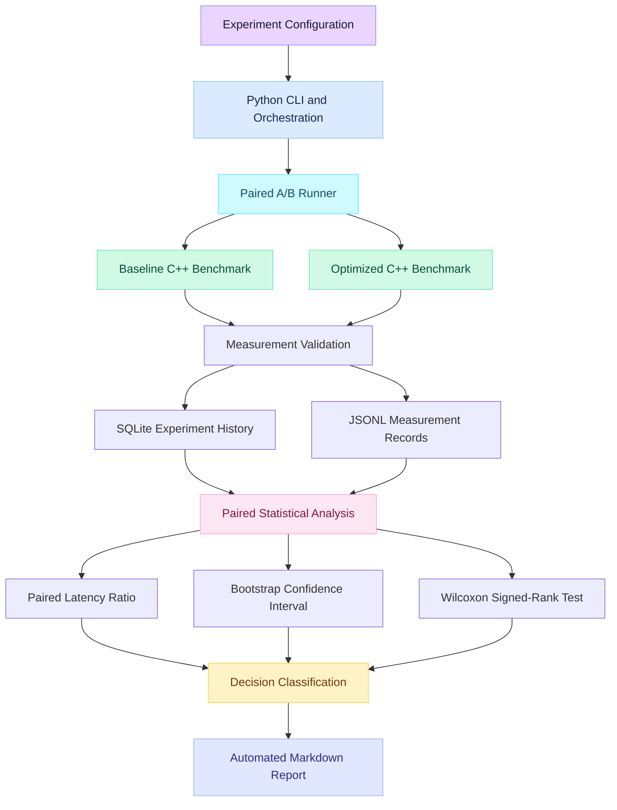

<div align="center">

# BenchForge

### Systems Performance · Reliability · Experimental Engineering

**Measure performance. Quantify uncertainty. Make evidence-based decisions.**

<p>
  <a href="https://github.com/gavneet0030/BenchForge">
    
  </a>
  
  
  
  
</p>

*A reproducible benchmarking toolkit for investigating performance changes, measurement noise, and statistical evidence.*

[Overview](#-the-project) ·
[Results](#-experimental-results) ·
[Architecture](#-system-architecture) ·
[Installation](#-installation) ·
[Workloads](#additional-native-workloads) ·
[Docker](#docker) ·
[Demo](#-demo) ·
[Research](#-experimental-methodology)

Architecture details: [system design](./docs/ARCHITECTURE.md) ·
[dataset catalog and provenance](./docs/DATASETS.md)

</div>

---

## 🔎 The project

### The real-world problem

Performance optimization is a common task in systems engineering. Developers change algorithms, remove expensive operations, improve memory access patterns, and tune native code to reduce latency.

But an optimization that appears faster in one measurement may not actually be faster.

Measurements can be affected by:

- CPU scheduling and background processes.
- Warm-up effects and runtime state.
- Compiler optimizations and build configuration.
- Workload characteristics and input distribution.
- Hardware, thermal conditions, and frequency scaling.
- Natural variation between repeated executions.

A single timing result cannot reliably distinguish a genuine improvement from measurement noise.

**The engineering question:** How can we compare two implementations, quantify uncertainty, and make a defensible decision about the observed performance difference?

### The solution

BenchForge is an experimental systems-performance toolkit that combines native C++ benchmarks with Python orchestration, persistent measurement storage, paired statistical analysis, and automated reporting.

Instead of relying on one timing or a simple average, BenchForge supports repeated baseline-versus-candidate experiments and evaluates their results using paired measurements, bootstrap confidence intervals, and a Wilcoxon signed-rank test.

The outcome is a reproducible experiment record and a Markdown report that explains what was measured, what the data supports, and what limitations remain.

### At a glance

| Dimension | Current implementation |
|---|---|
| Primary domain | Systems performance and reliability benchmarking |
| Demonstrated A/B workload | Native C++ hash-map lookup |
| Additional native workloads | CPU, memory throughput, temporary-file I/O, TCP loopback |
| Optimization investigated | Lookup-key generation without modulo in the measured loop |
| Experiment design | Repeated paired A/B measurements |
| Native language | C++20 |
| Orchestration and analysis | Python |
| Persistence | SQLite |
| Raw measurements | JSONL |
| Statistical analysis | Paired median ratio, bootstrap CI, Wilcoxon signed-rank test |
| Report output | Markdown |
| Build system | CMake (Ninja is optional) |
| Verification | pytest, Ruff, CTest |

---

## 🎯 Why BenchForge matters

A performance benchmark should do more than print elapsed time.

It should help answer five questions:

1. **Correctness:** Do both implementations produce the expected result?
2. **Measurement:** Were enough observations collected to inspect variation?
3. **Effect size:** How much did the measured latency change?
4. **Uncertainty:** How precise is the estimated performance difference?
5. **Decision:** Does the evidence satisfy the configured decision criteria?

BenchForge brings these concerns into one workflow.

The current implementation is a focused research prototype, not a universal performance-monitoring platform. Its demonstrated results apply to the tested workload and environment.

## 🧪 Experimental results

### Case study: optimizing native hash-map lookup

The current experiment compares a baseline C++ implementation with an optimized candidate that replaces modulo-based lookup-key progression with increment-and-wrap logic.

Both implementations are checked for correctness before their timing results are compared.

### Replicated results

Two independent experiments were performed on the same Windows machine and workload configuration.

| Metric | Experiment 1 | Experiment 2 |
|---|---:|---:|
| Paired observations | 30 | 30 |
| Warm-up runs per variant | 3 | 3 |
| Iterations per sample | 1,000,000 | 1,000,000 |
| Baseline median | 16.8019 ms | 16.7362 ms |
| Candidate median | 15.12095 ms | 15.0298 ms |
| Relative median change | -10.00% | -10.15% |
| Paired bootstrap 95% CI | [0.87662, 0.90477] | [0.89283, 0.90667] |
| Wilcoxon p-value | 0.0001374 | 0.000001684 |
| Configured decision | PASS | PASS |

*The confidence intervals are for the paired latency ratio. A ratio below 1.0 indicates lower candidate latency.*

### What did the experiment yield?

**Observed outcome:** The candidate's median latency was approximately 10% lower in both experiments.

The paired bootstrap confidence intervals were below 1.0, and both Wilcoxon signed-rank tests returned p-values below 0.05. Under the configured 3% regression threshold, both comparisons were classified as `PASS`.

This is encouraging evidence for the specific implementation, machine, compiler configuration, and workload tested.

It is not proof of a universal 10% improvement. A different processor, compiler, workload, or execution environment may produce a different result. Further validation across machines and workloads is needed before making broader claims.

### Reproducibility

The replication experiment used:

- 30 measured observations per variant.
- 3 warm-up runs per variant.
- 1,000,000 iterations per measured sample.
- Experiment seed `20261025`.
- Bootstrap confidence level of 95%.
- 5,000 bootstrap resamples for the generated report.
- A configured regression threshold of 3%.
- A significance level of 0.05.

**Replication run ID**

`c479d611-d75d-4c98-9a3b-713a9439bfee`

The stored run can be used to regenerate the corresponding report when the experiment database is available.

---

## 🏗️ System architecture

BenchForge separates the native benchmark from experiment control, persistence, statistical analysis, and reporting.



### Architecture components

| Component | Responsibility |
|---|---|
| Python CLI | Exposes benchmark, comparison, reporting, and diagnostic commands |
| A/B runner | Coordinates repeated baseline and candidate executions |
| Native C++ executables | Execute the workload and emit benchmark measurements |
| Runtime environment helper | Prepares the child-process environment for native execution on Windows |
| Measurement validation | Checks benchmark output and relevant data constraints |
| JSONL | Retains raw experiment observations |
| SQLite | Stores benchmark history for later comparison and report generation |
| Statistical module | Calculates ratios, confidence intervals, tests, and classifications |
| Report generator | Produces a human-readable summary of the stored experiment |

---

## 🔄 End-to-end workflow

```mermaid
flowchart LR
    A["Configure"] --> B["Build"]
    B --> C["Check Correctness"]
    C --> D["Warm Up"]
    D --> E["Measure Repeatedly"]
    E --> F["Validate Samples"]
    F --> G["Persist Results"]
    G --> H["Analyze Paired Data"]
    H --> I["Classify Evidence"]
    I --> J["Generate Report"]

    style A fill:#e9d5ff,stroke:#a78bfa,color:#1f1630
    style C fill:#d1fae5,stroke:#6ee7b7,color:#064e3b
    style E fill:#cffafe,stroke:#67e8f9,color:#164e63
    style H fill:#fce7f3,stroke:#f9a8d4,color:#831843
    style J fill:#e0e7ff,stroke:#a5b4fc,color:#312e81
```



1. **Configure:** Select the workload, iteration count, repetitions, warm-ups, and experiment parameters.
2. **Build:** Compile the native baseline and candidate implementations.
3. **Check correctness:** Verify that both executables return valid results and matching checksums.
4. **Warm up:** Execute the configured warm-up runs before collecting measured samples.
5. **Measure:** Run the baseline and candidate repeatedly under the experiment configuration.
6. **Validate:** Reject malformed records and, when workload parameters match, stop if paired output checksums differ. Each native process has a 30-second timeout.
7. **Persist:** Retain raw JSONL observations and store benchmark records in SQLite.
8. **Analyze:** Compute paired performance statistics and uncertainty estimates.
9. **Classify:** Apply the configured decision criteria.
10. **Report:** Generate a Markdown report with results, provenance, and limitations.

---

## 📐 Experimental methodology

### 1. Paired performance comparison

The analysis preserves the relationship between corresponding baseline and candidate observations.

For a paired observation \(i\), define the latency ratio as

\[
r_i = \frac{T_{\mathrm{candidate},i}}
           {T_{\mathrm{baseline},i}}
\]

where \(T\) represents measured elapsed time.

The paired median ratio is estimated using the median of the log-transformed paired ratios:

\[
R = \exp\left(\operatorname{median}
\left(\log r_i\right)\right)
\]

Interpretation:

- \(R < 1\): the candidate has lower latency.
- \(R = 1\): the estimated paired ratio is 1.
- \(R > 1\): the candidate has higher latency.

The relative change in latency is reported as

\[
100(R-1)\%
\]

Negative values indicate lower candidate latency.

### 2. Bootstrap confidence interval

BenchForge uses paired bootstrap resampling to estimate a confidence interval for the latency ratio.

The analysis resamples paired observations together, preserving each baseline/candidate relationship. The resulting interval communicates uncertainty in the estimated ratio under the resampling procedure.
BenchForge requires at least five paired observations before it calculates inferential comparisons or reports; fewer observations remain persistable but cannot support a decision.

### 3. Wilcoxon signed-rank test

The paired Wilcoxon signed-rank test evaluates evidence of a systematic difference between paired measurements.

Its p-value is interpreted alongside the estimated effect size, confidence interval, sample count, and experimental design. A small p-value alone does not establish that an improvement is practically important.

### 4. Decision classification

The report generator supports three classifications:

| Decision | Meaning |
|---|---|
| `PASS` | The confidence interval satisfies the configured non-regression criterion |
| `REGRESSION` | The estimated interval exceeds the configured regression threshold and the statistical test satisfies the configured significance criterion |
| `INCONCLUSIVE` | The evidence does not satisfy either decision rule |

The threshold and significance level are configurable. `PASS` does not prove equivalence, and `INCONCLUSIVE` does not prove that the implementations are equal.

---

## 🗃️ Data and provenance

### What data does BenchForge use?

The demonstrated benchmark uses a controlled native hash-map lookup workload with generated lookup inputs and a deterministic checksum check.

**The demonstrated performance experiment does not depend on an external business dataset or a Kaggle dataset.** Its primary data consists of benchmark measurements produced by running the baseline and candidate executables. The optional public-data case studies below are separate analytics examples, not inputs to the performance experiment.

### Data flow

| Data artifact | Purpose |
|---|---|
| Generated lookup inputs | Drive the controlled benchmark workload |
| Native JSON output | Carries measurement results and checksum information |
| JSONL experiment records | Preserve raw observations for inspection |
| SQLite database | Stores benchmark samples and experiment history |
| Run configuration | Captures relevant workload and experiment parameters |
| Markdown report | Summarizes results, uncertainty, statistical tests, and limitations |

### Why retain raw measurements?

Raw measurements make it possible to investigate variability, inspect individual observations, reproduce statistical analysis, and distinguish experimental data from conclusions derived from it.

A summary statistic without its underlying observations and configuration is less useful for independent review.

### Example experiment record

A simplified conceptual measurement record might contain:

```json
{
  "variant": "baseline",
  "workload": "hash_lookup",
  "iterations": 1000000,
  "elapsed_ns": 16800000,
  "checksum": 8494500
}
```

This is an illustrative example of the measurement fields, not a claim that it is an exact stored JSONL row. The actual record schema and required fields are defined by the implementation.

---

## 🧰 Technology stack and why each tool is used

| Technology | Role in BenchForge | Why it is used |
|---|---|---|
| **C++20** | Native benchmark implementation | Executes low-level workloads with direct control over the code being measured |
| **Python** | Experiment orchestration | Coordinates runs, validation, analysis, and report generation |
| **CMake** | Native build configuration | Defines targets and integrates native tests |
| **Ninja** | Build execution | Provides an efficient incremental native build workflow |
| **NumPy** | Numerical computation | Supports array and numerical operations used in analysis |
| **SciPy** | Statistical testing | Provides the paired Wilcoxon signed-rank test |
| **SQLite** | Experiment persistence | Stores measurements for later comparisons and reports |
| **JSONL** | Raw data storage | Keeps observations in a portable line-oriented format |
| **pytest** | Python verification | Tests CLI behavior, validation, statistics, and runner functionality |
| **Ruff** | Python linting | Checks code quality and common Python issues |
| **CTest** | Native verification | Runs automated baseline and optimized executable correctness tests |
| **Git and GitHub** | Version control | Track changes and publish the research implementation |

---

## Demo
**Demo video:** A recorded demonstration link has not yet been added.

The intended demo should show the following workflow:

1. Build the baseline and optimized native executables.
2. Run a paired A/B benchmark.
3. Inspect the generated measurement records.
4. Run statistical comparison and inspect the decision.
5. Generate and open the Markdown experiment report.
6. Re-run the report from a stored experiment ID.

To add your recording, replace the placeholder below with a public video URL.

**Recording status:** An end-to-end demo video has not been published yet.

The planned walkthrough will demonstrate native builds, paired A/B execution, statistical comparison, and automated report generation.

> A public demo link will be added here when the recording is available.

Recommended recording: a short terminal walkthrough followed by the generated report. Show the commands, the final decision, the confidence interval, and the limitations section rather than only displaying a performance percentage.

---

## Installation
### Prerequisites

Prerequisites are Python 3.12 or newer, a C++20-capable compiler, CMake 3.20 or newer, and Git. Install a supported compiler toolchain for your operating system (for example, Visual Studio Build Tools on Windows or `g++`/Clang on Linux).

### Step 1

```powershell
git clone https://github.com/gavneet0030/BenchForge.git
cd BenchForge
```

### Step 2

```powershell
py -m venv .venv
.\.venv\Scripts\python.exe -m pip install --upgrade pip
```

### Step 3

Install the project and development dependencies:

```powershell
.\.venv\Scripts\python.exe -m pip install -e ".[dev]"
```

For a runtime-only installation without development dependencies:

```powershell
.\.venv\Scripts\python.exe -m pip install -e .
```

### Step 4

Configure the native C++20 targets with CMake:

```powershell
cmake -S native -B build/native -DCMAKE_BUILD_TYPE=Release
```

Build the executables:

```powershell
cmake --build build/native --config Release --parallel
```

Run native correctness tests:

```powershell
ctest --test-dir build/native -C Release --output-on-failure
```

The same commands work on Linux with a C++20 toolchain. On a single-configuration generator, `--config Release` is ignored; `CMAKE_BUILD_TYPE=Release` selects the build type.

For Ubuntu or WSL, install the compiler and Python environment tools, then use a POSIX virtual environment:

```bash
sudo apt-get update
sudo apt-get install -y build-essential cmake python3 python3-venv
python3 -m venv .venv
source .venv/bin/activate
python -m pip install --upgrade pip
python -m pip install -e ".[dev]"
cmake -S native -B build/native -DCMAKE_BUILD_TYPE=Release
cmake --build build/native --parallel
ctest --test-dir build/native --output-on-failure
```

### Step 5

```powershell
.\.venv\Scripts\python.exe -m benchforge.cli --help
```

Inspect available command options:

```powershell
.\.venv\Scripts\python.exe -m benchforge.cli doctor --help
.\.venv\Scripts\python.exe -m benchforge.cli run --help
.\.venv\Scripts\python.exe -m benchforge.cli ab --help
.\.venv\Scripts\python.exe -m benchforge.cli compare --help
.\.venv\Scripts\python.exe -m benchforge.cli report --help
.\.venv\Scripts\python.exe -m benchforge.cli workload --help
```

Use the help output from your checkout as the source of truth for supported arguments.

### Paired A/B benchmark

The paired A/B command currently compares the baseline and optimized hash-lookup executables:

```powershell
benchforge ab --runs 30 --warmup 3 --iterations 100000
benchforge compare --run-id RUN_ID --database data/benchforge.sqlite
benchforge report --run-id RUN_ID --database data/benchforge.sqlite --output reports/generated/result.md
```

Use the run ID printed by `ab`. The comparison requires at least five matched pairs for inference; the A/B execution itself reports descriptive medians, not a significance verdict. Build artifacts, compiler, host, workload settings, and operating conditions affect comparability.

### Additional native workloads

The `workload` command runs a single bounded native workload, writes raw JSONL
observations, and stores the run in SQLite. `compare-workloads` compares seven
bounded equivalent Python/native workload families after checksum validation;
each workload gets a homogeneous run ID.

After building the native targets, the CLI searches `build/native/Release`, `build/native`, and `build/native-ucrt64` for the workload executable. You can also pass `--binary` explicitly:

```powershell
benchforge workload --workload cpu --runs 10 --warmup 2 --iterations 100000
benchforge workload --workload memory --working-set-kib 1024 --iterations 10
benchforge workload --workload file_io --file-size-kib 1024 --iterations 1
benchforge workload --workload tcp_loopback --iterations 100
```

By default, results go to `data/raw/workload-latest.jsonl` and `data/benchforge.sqlite`. Use `--output` and `--database` to select other paths. Memory, file I/O, and TCP workloads also report median throughput where applicable. The file I/O workload uses buffered temporary-file writes and reads; it does not explicitly call fsync or FlushFileBuffers, so results can reflect operating-system page-cache and filesystem caching rather than durable-media throughput. Limits are enforced by both the Python runner and native executable: 1,000 runs and 100 warm-ups maximum; CPU at most 100 million iterations per sample and one billion across the run; memory at most 65,536 KiB per working set and 256 MiB of working-set-by-iteration volume across the run (up to 512 MiB counted as reads plus writes); file I/O at most 16,384 KiB per file and 128 MiB of file-size-by-iteration volume across the run (up to 256 MiB counted as reads plus writes); TCP loopback at most 100,000 64-byte round trips across the run. Each native process has a 30-second timeout. The TCP workload starts its own server bound only to the loopback interface; it does not connect to external hosts.

### Optional dbt analysis of benchmark history

The optional dbt-duckdb project uses a synthetic CSV seed by default. To
analyze an explicit snapshot of local SQLite history, export it and point dbt
at the new local CSV:

```powershell
$historyCsv = Join-Path $env:TEMP "benchforge-history.csv"
benchforge export-history --database "data/benchforge.sqlite" --output $historyCsv
$env:BENCHFORGE_HISTORY_CSV_PATH = $historyCsv
```

Follow [the dbt workflow](./dbt/benchforge_analytics/README.md) to run the
models. The export is read-only, capped at 100,000 rows and 10 MB, and refuses
to overwrite an existing output file. It is not a live synchronization or a
distributed database integration.

### Supported Python and CI

The package requires Python 3.12 or newer. CI is configured for Python 3.12, 3.13, and 3.14 on Ubuntu and Windows. The 2026-10-29 local audit ran on Windows with Python 3.14.2 and MSYS2 UCRT64 GCC 16.2. Remote CI results were not inspected, and the Docker daemon was unavailable to the local audit; Linux and container runtime results remain unverified.

BenchForge is currently an **alpha research prototype (version 0.1.0)**. No public release is represented by this worktree.

---

## 📊 Reproducing the stored replication report

The following command regenerates the report for the verified replication run, assuming its SQLite database is available locally.

```powershell
.\.venv\Scripts\python.exe -m benchforge.cli report `
  --run-id "c479d611-d75d-4c98-9a3b-713a9439bfee" `
  --database "data/benchforge.sqlite" `
  --output "reports/generated/lookup-optimization-replication.md" `
  --threshold 0.03 `
  --confidence 0.95 `
  --n-resamples 5000 `
  --seed 2026 `
  --alpha 0.05 `
  --force
```

**Important:** The command reproduces the report from stored measurements; it does not rerun the original benchmark. The database and associated experiment records must be available.

The `--force` option permits overwriting the output report. Use it only when you intend to replace the existing file.

---

## ✅ Testing and quality gates

The verified development revision passed these checks:

| Check | Verified outcome |
|---|---|
| Python test suite | Latest local Phase 1 check: 194 passed; see [FINAL_VERIFICATION.md](./docs/FINAL_VERIFICATION.md) for the dated command and platform details. |
| Ruff | All checks passed |
| Native C++ build | Passed with MSVC 19.44 |
| Native CTest | 3 of 3 passed |
| Git diff check | Passed |

These are results from the verified development revision, not a guarantee that every future checkout or toolchain will produce identical results.

Run the Python test suite:

```powershell
$testBase = Join-Path $env:TEMP ("BenchForge-pytest-" + [guid]::NewGuid().ToString("N"))
$env:PYTHONDONTWRITEBYTECODE = "1"
.\.venv\Scripts\python.exe -m pytest -q -p no:cacheprovider --basetemp $testBase tests/
```

Run lint:

```powershell
.\.venv\Scripts\python.exe -m ruff check --no-cache .
```

Run native tests:

```powershell
ctest --test-dir build/native -C Release --output-on-failure
```

---

## Repository Structure
```text
BenchForge/
|-- .github/
|   `-- workflows/
|-- docs/
|   `-- RESEARCH_PLAN.md
|-- native/
|   |-- src/
|   |   |-- lookup.cpp
|   |   |-- lookup_optimized.cpp
|   |   `-- workloads.cpp
|   |-- tests/
|   |   |-- test_lookup.cmake
|   |   `-- test_workloads.cmake
|   `-- CMakeLists.txt
|-- Dockerfile
|-- compose.yaml
|-- src/
|   `-- benchforge/
|       |-- ab.py
|       |-- cli.py
|       |-- dashboard.py
|       |-- exports.py
|       |-- history.py
|       |-- pipeline.py
|       |-- public_data.py
|       |-- runner.py
|       |-- stats.py
|       `-- workload.py
|-- tests/
|   `-- unit/
|-- data/
|-- experiments/
|-- reports/
|   `-- generated/
|-- README.md
`-- pyproject.toml
```

Directory contents can vary between local and fresh repository checkouts; generated data and build artifacts may be excluded from version control.

---

## Local analytics dashboard

BenchForge includes a local dashboard with a light theme and dark, readable text. It reads SQLite history and processed public-data summaries and provides a bounded local PDF upload workflow. It binds to loopback by default; the UI does not accept executable paths or launch benchmark processes.

Start it after installing the package:

```powershell
benchforge dashboard --database data/benchforge.sqlite
```

Open `http://127.0.0.1:8765`. The dashboard has Overview, Benchmark Explorer, Reliability & Regression, Public Data Analytics, Data Quality & Provenance, Pipeline Runs, PDF Analysis, and Run / Export sections. Overview shows recent pipeline counts, failures, failed quality checks, and latest duration; Pipeline Runs lists up to 100 persisted local executions with throughput, row counts, duration, and quality checks. Empty history and missing public-data summaries show explicit empty states. CSV downloads are generated from saved SQLite observations. The dashboard renders SVG charts locally and does not load remote charting scripts.

The PDF page accepts text-based PDFs up to 10 MiB and 200 pages by default. Configure the byte limit with `--max-pdf-bytes` (1 byte through 50 MiB) and storage with `--documents-dir`; by default, uploaded PDFs and extracted text are stored under `data/documents/` using generated IDs. PDF processing uses pypdf locally, performs no OCR, and sends no file or extracted text to an external service. Encrypted, malformed, non-PDF, and oversized inputs are rejected. The parser is not an operating-system sandbox; only analyze files you trust.

Dashboard settings can be supplied as options or environment variables. An
explicit command-line option takes precedence over its environment variable.
Relative paths are resolved from the directory where the command is run.

| Option | Environment variable | Default |
|---|---|---|
| `--database` | `BENCHFORGE_DATABASE` | `data/benchforge.sqlite` |
| `--data-dir` | `BENCHFORGE_DATA_DIR` | `data/public_datasets/processed` |
| `--documents-dir` | `BENCHFORGE_DOCUMENTS_DIR` | Database directory plus `documents/` (`data/documents/` by default) |
| `--max-pdf-bytes` | `BENCHFORGE_MAX_PDF_BYTES` | 10 MiB |
| `--host` | `BENCHFORGE_HOST` | `127.0.0.1` |
| `--port` | `BENCHFORGE_PORT` | `8765` |

On Windows, `BENCHFORGE_NATIVE_RUNTIME_DIR` optionally adds an existing
directory to the native child process search path. It does not replace the
existing `PATH`. BenchForge has no separate configuration file; other CLI
defaults are defined by their commands.

## Optional React web application

The React interface is a separate, optional local web application; it does not
replace the dashboard above. Install the API dependencies and start the backend
from the repository root:

```powershell
python -m pip install -e ".[web]"
benchforge web --database data/benchforge.sqlite
```

The API binds only to `127.0.0.1` and listens on port `8766` by default. Keep
the default loopback binding: the application has no authentication and is not
intended for public exposure. The selected SQLite database is initialized when
the service starts.

For frontend development, install the npm dependencies in `frontend/` and run
the Vite server in a second terminal:

```powershell
Set-Location frontend
npm install
npm run dev
```

Open `http://127.0.0.1:5173`; Vite proxies API requests to the local backend.
To build the static UI instead, run `npm run build` in `frontend/`, then start
`benchforge web` from the repository root; the backend serves the generated
`frontend/dist` files when present. Python CPU runs work without a native
binary. C++ workloads and equivalent Python/C++ comparisons are enabled only
when the corresponding native executable is available. The UI shows optional
integration package availability, not whether external services are running.

## Local ETL pipelines

The `pipeline` CLI group provides bounded local file ingestion and analysis using the existing SQLite database:

1. **File ingestion** accepts CSV, JSON arrays of objects, JSONL (one object per non-empty line), and Parquet; it normalizes column names, validates optional required columns, profiles values, detects duplicate rows, and atomically replaces a destination table.
2. **Multi-file normalization** combines 2–50 CSV files whose normalized schemas match, including when their column order differs.
3. **Analytical aggregation** creates grouped row counts, sums, and means from an ingested table.

Example:

```powershell
benchforge pipeline ingest .\data\input.jsonl --table source_rows --database .\data\benchforge.sqlite
benchforge pipeline ingest .\data\input.parquet --table parquet_rows --database .\data\benchforge.sqlite
benchforge pipeline ingest-csv .\data\input.csv --table source_rows --database .\data\benchforge.sqlite
benchforge pipeline normalize .\data\part-1.csv .\data\part-2.csv --table combined_rows --database .\data\benchforge.sqlite
benchforge pipeline aggregate --source-table source_rows --group-by region --metric amount --destination regional_summary --database .\data\benchforge.sqlite
benchforge pipeline export-csv --table regional_summary --database .\data\benchforge.sqlite --output .\reports\regional-summary.csv
```

Formats are detected from `.csv`, `.json`, `.jsonl`/`.ndjson`, and `.parquet` extensions or can be set with `--format`. Parquet uses the optional `datasets` dependency extra (`pyarrow`); `--column` can select one or more columns (Parquet reads the selected columns in bounded batches). A run is capped at 20 MB of source and expanded text data, 100,000 rows, 200 columns, and 65,536 characters per cell. Malformed-width/schema-drift and oversized-cell records are counted as rejected. The loader stores values as text to avoid silently coercing source data; aggregation rejects non-numeric metric values and skips blank metric values. SQLite persists run status, row counts, duration, throughput, quality checks, configuration, source/output checksums, and source-to-table transformation lineage in the load transaction. `pipeline export-csv` exports an ingested or aggregated table, with spreadsheet-formula protection and bounded output size; the top-level `export-csv` command remains for benchmark observations. The dashboard exposes recent run summaries read-only; run pipelines from the CLI. This initial pipeline layer does not yet include retry scheduling or remote orchestration.

### Optional analytics, quality, and catalog tools

SQLite remains the application history and pipeline-output store. Install the
optional extras only when you need the associated local analytics tools:

```powershell
python -m pip install -e ".[analytics,polars,dbt]"
benchforge analytics inspect .\data\input.csv
benchforge analytics summarize .\data\input.csv --group-by region --metric amount
benchforge quality validate .\data\input.csv --required-column region --not-null amount --numeric-range amount:0:
benchforge catalog list --database .\data\benchforge.sqlite
```

DuckDB provides bounded, read-only inspection and grouped summaries for local
CSV and Parquet files; it is not the pipeline or benchmark-history database.
Polars is an optional Python API adapter for lazy CSV/Parquet summaries (not a
separate CLI command). The read-only quality validator supports declared
schema, nullability, uniqueness, range, allowed-value, string-length, and row
count rules. `catalog validate` is an alias that can save its report to SQLite
with `--database`; successful pipeline ingestion records dataset metadata and
lineage alongside the table replacement. A small optional dbt-duckdb example
is under [`dbt/benchforge_analytics`](./dbt/benchforge_analytics/README.md);
its checked-in synthetic seed is not actual benchmark history. See the
[Iceberg compatibility investigation](./docs/ICEBERG_COMPATIBILITY.md) for
the current research boundary.

## Docker

Docker Compose builds the Python application and native workload executable, then persists history and processed summaries in a named volume. The host port is loopback-only by default:

```powershell
docker compose up --build
```

Open `http://127.0.0.1:8765`; stop the service with `Ctrl+C`. The dashboard listens on all interfaces inside the container, while Compose publishes it only on `127.0.0.1`. Do not change `BENCHFORGE_BIND` to a public interface unless you intend to expose the dashboard and have secured access to it. To change the host port, set `BENCHFORGE_PORT` before running Compose.

Container image build and runtime were not verified locally because the Docker Desktop Linux daemon was unavailable in the validation environment. A separate Ubuntu CI job is configured to build the image, check the health endpoint, execute a workload, and verify persisted history; its remote result has not been checked.

## Public-data case studies

The optional dataset readers are separate from routine tests and the normal runtime dependencies. The following commands download only the named archive or one monthly taxi file, then write compact JSON aggregates for offline dashboard use. Original files are kept under the ignored `data/public_datasets/raw/` directory.

```powershell
benchforge datasets list
benchforge datasets fetch bike
benchforge datasets validate bike --source data/public_datasets/raw/bike-sharing-dataset.zip
# Or fetch and validate a supported source in one step:
benchforge datasets validate taxi --download --max-rows 100000
python -m pip install -e ".[datasets]"
python -m benchforge.public_data --dataset bike --download
python -m benchforge.public_data --dataset retail --download
python -m benchforge.public_data --dataset taxi --download --max-rows 100000
```

The catalog contains seven sources, and five have bounded processors.
`benchforge datasets list` reports metadata and local artifact presence
without network access. The `fetch` and `validate` commands operate only on
implemented sources and enforce configured download bounds. See
[dataset status, terms, and artifact inventory](./docs/DATASETS.md) before
redistributing any source or derived output.

| Case study | Source and analysis | Cleaning and interpretation |
|---|---|---|
| NYC Yellow Taxi | [NYC TLC Trip Record Data](https://www.nyc.gov/site/tlc/about/tlc-trip-record-data.page), January 2024 Parquet. Processes the first 100,000 rows in file order by default; charts pickup hour, distance bands, and binned base-fare/distance observations. | Requires valid pickup/drop-off times, positive duration and distance, and non-negative base fare. This is a bounded file-order sample, not a random or seasonally representative sample. Base fare is USD, not total charges or profit. The TLC source page did not return to this environment during verification; the script uses the published monthly CloudFront file URL. Review current TLC terms before redistribution. |
| UCI Online Retail | [UCI Online Retail](https://archive.ics.uci.edu/dataset/352/online+retail). Monthly gross sales in GBP, top products, country sales, and invoice-value bands. | Cancellation invoices beginning with `C`, nonpositive-quantity lines, and zero-price lines are excluded from positive gross sales; negative prices and incomplete required values are counted. Missing customer IDs remain in sales totals but are counted. Gross sales are not profit. Licensed CC BY 4.0; cite Chen (2015), DOI [10.24432/C5BW33](https://doi.org/10.24432/C5BW33), and UCI. Verify the current source record before redistribution. |
| UCI Bike Sharing | [UCI Bike Sharing](https://archive.ics.uci.edu/dataset/275/bike+sharing+dataset), hourly `hour.csv` (2011–2012). Charts monthly and hourly demand, rider type, and normalized temperature bands. | Uses the documented `cnt`, `casual`, `registered`, `hr`, `dteday`, and normalized `temp` fields; converts hourly temperature from the documented `[-8, 39] °C` normalization. The dataset is licensed CC BY 4.0; cite Fanaee-T (2013), DOI [10.24432/C5W894](https://doi.org/10.24432/C5W894). Associations are descriptive, not causal. |
| UCI Household Power | [Individual Household Electric Power Consumption](https://archive.ics.uci.edu/dataset/235/individual+household+electric+power+consumption), 1-minute measurements. Summarizes monthly/hourly active power, voltage, and sub-metering totals. | Streams the semicolon-delimited text from ZIP without extracting it to disk; missing values are counted per field and excluded only from the affected metric. The dataset is licensed CC BY 4.0; cite Hebrail and Berard (2006), DOI [10.24432/C58K54](https://doi.org/10.24432/C58K54). |
| UCI Wine Quality | [Wine Quality](https://archive.ics.uci.edu/dataset/186/wine+quality), red and white Vinho Verde samples. Summarizes quality scores and alcohol levels by color and quality. | Requires both source CSV files and validates numeric target fields. Quality is a sensory score, not consumer preference or commercial value. Licensed CC BY 4.0; cite Cortez et al. (2009), DOI [10.24432/C56S3T](https://doi.org/10.24432/C56S3T). |

Each generated summary records its source URL, access date, terms note, row count, source filename, size, SHA-256, quality counters, and transformations. Tests use tiny local fixtures; they never download network data. Processing requires the `datasets` extra (`openpyxl` for the retail workbook and `pyarrow` for taxi Parquet); household and wine use the standard library.

### Six analysis-source status

| Source | Current status |
|---|---|
| Retail transactions | Optional Online Retail aggregation is implemented; verify the current source terms before redistribution. |
| Bike sharing | Optional UCI Bike Sharing aggregation is implemented with CC BY 4.0 attribution recorded. |
| Taxi trips | Optional bounded TLC Parquet aggregation is implemented; verify current TLC terms before redistribution. |
| Synthetic financial transactions | Not implemented yet; no synthetic outcomes or fraud labels are currently generated. |
| BenchForge benchmark history | Available in the existing benchmark explorer, historical comparison, and CSV export; not yet a general-purpose analytical source. |
| User-selected local files | Bounded CSV, JSON, JSONL, and Parquet ingestion and CSV normalization/aggregation are available from the CLI. Local PDF upload and text analysis are available in the dashboard. |

## Historical comparison and CSV export

Compare a run with an explicitly selected historical reference:

```powershell
benchforge compare-history --run-id CURRENT --reference-run-id REFERENCE --database data/benchforge.sqlite
```

The command uses independent median-ratio bootstrap and Mann–Whitney analysis and rejects workload, iteration, extra-work, operating-system, schema, or sample-count incompatibilities. It does not choose a reference automatically. Export a run or all stored samples using stable CSV columns:

```powershell
benchforge export-csv --run-id CURRENT --database data/benchforge.sqlite --output reports/current-samples.csv
```

## Limitations and Research Integrity
BenchForge is an active research and development project. Its current evidence has specific boundaries:

- The demonstrated benchmark is a hash-map lookup microbenchmark, not a representative suite of all systems workloads.
- The CPU, memory, temporary-file I/O, and loopback TCP workloads can run as
standalone observations. The separate `compare-workloads` command compares
seven bounded, checksum-verified Python/native workload families.
- The reported experiments were run on one machine.
- Statistical tests do not remove systematic measurement bias or guarantee sound experimental design.
- CPU state, compiler configuration, workload selection, and background processes can influence results.
- The configured decision threshold is an engineering policy, not a universal definition of a regression.
- The current results do not establish cross-platform performance.
- The local ETL layer supports bounded CSV, JSON, JSONL, and Parquet ingestion, compatible multi-file CSV normalization, and grouped count/sum/mean analytics. Local PDF text analysis is available in the dashboard (without OCR).
- The dashboard exposes pipeline run summaries but remains read-only. Pipeline execution and file selection are CLI-only; synthetic finance analysis and generalized data contracts are not available.
- DuckDB, Polars, and dbt integrations are optional local tools; they do not replace SQLite history or pipeline storage. Iceberg is not implemented.
- Broader workload coverage, environmental quality gates, and validation across multiple machines remain future work.

The objective is not to make every benchmark result look positive. It is to make the evidence, assumptions, uncertainty, and limitations explicit.

---

## Roadmap
- [x] Native baseline hash-map lookup benchmark
- [x] Optimized candidate implementation
- [x] Baseline and candidate correctness checks
- [x] Python benchmark orchestration
- [x] SQLite-backed benchmark history
- [x] Paired statistical comparison
- [x] Bootstrap confidence intervals
- [x] Wilcoxon signed-rank test
- [x] Configurable decision classification
- [x] Automated Markdown report generation
- [x] Additional bounded native workload families
- [x] Bounded CSV ingestion, normalization, aggregation, and persisted pipeline provenance
- [x] Dashboard pipeline-run history view
- [x] PDF upload, extraction, and analysis (local text extraction; no OCR; not an OS sandbox)
- [ ] Synthetic finance analysis and broader benchmark-history analytics
- [x] Bounded JSON/JSONL and Parquet ingestion
- [x] Optional DuckDB/Polars analytics, declarative quality validation, and SQLite catalog/lineage
- [x] Local dbt-duckdb example project
- [x] Iceberg compatibility investigation (documentation only; no Iceberg support implemented)
- [ ] Interactive dashboard pipeline execution
- [ ] Broader compiler and machine validation
- [ ] Stronger environmental noise diagnostics
- [ ] Sample-size sensitivity studies
- [x] Cross-platform Python CI matrix and container smoke workflow
- [ ] Recorded end-to-end demo
- [ ] Additional report visualizations

---

## 🤝 Engineering principles

BenchForge is guided by a few principles:

- **Reproducibility:** Retain configuration and raw observations.
- **Correctness first:** Validate results before interpreting timings.
- **Statistical transparency:** Report effect sizes, uncertainty, and test outcomes.
- **Honest conclusions:** Separate measured outcomes from general claims.
- **Explicit limitations:** Document where evidence does and does not apply.
- **Maintainability:** Keep the native workload, orchestration, statistics, and reporting responsibilities distinct.

## Contributing and security

See [CONTRIBUTING.md](./CONTRIBUTING.md) for development and pull-request guidance and [SECURITY.md](./SECURITY.md) for private vulnerability reporting and deployment boundaries. The dashboard is unauthenticated; loopback binding is not authentication. Public exposure requires a trusted security layer.

## 📄 License

See the repository's `LICENSE` file for the applicable license terms.

The MIT license applies to the project code. Public-data source licenses and terms are separate: in particular, confirm current UCI Online Retail and NYC TLC terms before publishing or redistributing any derived summaries. See [dataset provenance and terms](#public-data-case-studies).

---

<div align="center">

### Measure carefully. Quantify uncertainty. Engineer with evidence.

**BenchForge — Experimental performance engineering, made reproducible.**

</div>
