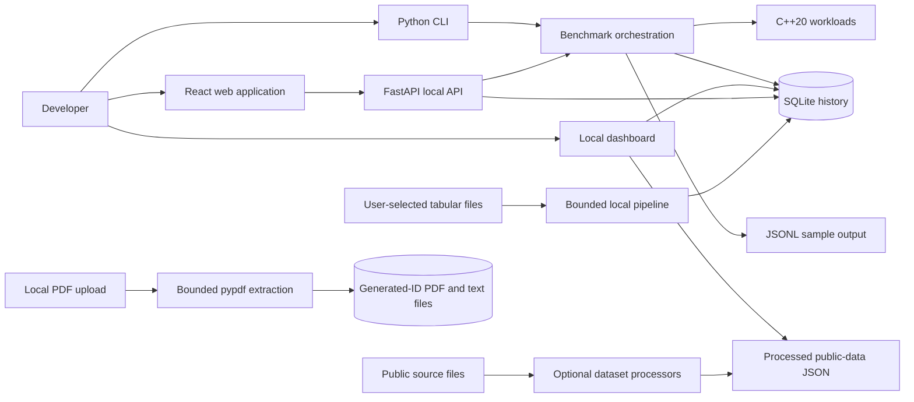

# BenchForge architecture

This note describes the implemented local architecture and explicitly
separates it from proposed or incomplete features. The Python package is the
control plane; native C++ executables perform benchmark workloads. The
dashboard and data utilities are local supporting surfaces, not remote
services.

## System context

The dashboard defaults to loopback and reads benchmark history and pipeline
metadata from SQLite. It also reads the compact JSON summaries created by the
optional public-data processors. Pipeline execution and dataset fetching are
CLI/local operations; the dashboard accepts only bounded local PDF uploads and
does not execute arbitrary pipelines.

The optional React web application is a separate interface from the existing
standard-library dashboard. `benchforge web` starts its FastAPI API on
loopback, serves `frontend/dist` when a frontend build is present, and uses the
same SQLite history store. The browser API provides bounded benchmark
submission, status and cancellation for queued jobs, history and analytics,
compatibility-checked comparisons, and per-run CSV, JSON, and PDF downloads.
Only one benchmark executes at a time; the queue has a fixed limit, inputs and
timeouts are bounded, and equivalent CPU runs validate matching results
before timing. The API does not accept arbitrary commands or output paths.
FastAPI and Uvicorn are optional dependencies; the frontend has its own npm
manifest. For development, run the API and Vite development server separately;
Vite proxies API requests to the loopback backend.

## Benchmark path

1. The Python CLI validates configuration and starts paired baseline and
   candidate benchmark processes.
2. C++20 workload executables perform the requested work and emit structured
   measurements.
3. Python validates results, records sample data in JSONL, and stores run
   metadata/history in SQLite.
4. Analysis computes paired statistics and applies configured decision
   criteria; the report generator writes Markdown.

This path is designed for repeatable experiments. Results remain specific to
the selected machine, compiler, workload, configuration, and observed run.

The bounded `compare-cpu` command validates that the Python and C++ xorshift
loops produce the same 64-bit checksum before recording paired timings. Its
seeded execution order and shared run ID are written as JSONL. `compare-engines`
uses identical deterministic rows and a group/count/sum query in in-memory
SQLite and optional one-thread DuckDB; it validates both results before timing
and excludes table setup from query timings. These commands are descriptive
local experiments, not portable performance claims.

`compare-workloads` adds seven deterministic Python/native workload families:
sorting, searching, array operations, aggregation, hash lookup, text-file
parsing, and numeric operations. It validates checksums before timing and uses
a distinct homogeneous run ID per workload. `benchmark-formats` generates
bounded files outside the repository and measures warm-cache CSV, JSON, and
JSONL reads; Parquet is opt-in and uses the optional `datasets` extra. File
generation and validation are outside timed reads. These timings describe the
local filesystem cache and do not claim cold-storage performance.

Native workload results include an OS-reported process peak-memory value and
its source. Windows also reports current working set and private commit bytes;
these values are null on platforms where this implementation does not have a
verified current-memory API. Linux reports the process thread count from
`/proc/self/task`, Windows uses the Toolhelp thread snapshot, and other
platforms report null. Process CPU time uses the standard C clock; CPU time and
utilization are withheld for samples shorter than 100 ms because the observed
timer resolution is too coarse for a reliable utilization ratio. Windows
working-set peak and POSIX `ru_maxrss` are process-lifetime high-water marks,
not workload-only allocation deltas. SQLite history persists the available
measurements, memory source, and CMake compiler/build identity. Historical
comparisons require compatible workload, platform, and build metadata and at
least five observations in each run.
Bootstrap intervals, the configured regression threshold, and the p-value
must jointly support a regression; noisy or borderline results remain
inconclusive. Potential outliers are labeled and never removed.

The shared metric summary uses nearest-rank percentiles. P99 is withheld
below 100 observations; P90/P95 remain descriptive. Repeatability is labeled
using the sample coefficient of variation after five observations by default
and a default 5% threshold. This repeatability label does not itself infer a
performance regression.

## Configuration and console output

BenchForge does not have a separate application configuration file or
settings framework. Typer command options provide defaults; the dashboard
also accepts `BENCHFORGE_DATABASE`, `BENCHFORGE_DATA_DIR`,
`BENCHFORGE_DOCUMENTS_DIR`, `BENCHFORGE_MAX_PDF_BYTES`,
`BENCHFORGE_HOST`, and `BENCHFORGE_PORT`. An explicitly supplied option
overrides its environment variable. Relative paths are based on the current
working directory. On Windows, `BENCHFORGE_NATIVE_RUNTIME_DIR` can add an
existing compiler-runtime directory to the child process `PATH` while
preserving the rest of that environment variable.

Rich/Typer output is used for interactive command results. The dashboard keeps
startup and shutdown messages on the console and emits request records through
Python logging. Request records contain the method, a normalized route, status,
and duration; query strings, document IDs, and request bodies are excluded.
The dashboard exposes `/healthz` for liveness, `/readyz` for a read-only
database availability check, and `/metrics` for bounded in-process request
counters, duration totals, and read-only database sample counts.
`/metrics/prometheus` presents these observations in the Prometheus text
exposition format without adding a client dependency.
[`dashboards/benchforge-overview.json`](../dashboards/benchforge-overview.json)
is an importable Grafana dashboard for those metric names. Metrics reset on
restart and are not durable or production monitoring. OpenTelemetry SDK
instrumentation is deferred: the application is a single local process with no
distributed request path, so tracing has no current consumer. Revisit this
decision if remote services or cross-process traces are introduced. No file
logging is configured.
In default loopback mode, the request `Host` must be `localhost` or a loopback
IP with the server's port; this prevents DNS-rebinding hostnames from reading
local dashboard data. `--allow-remote` is an explicit opt-in to remote access
and remote Host values.

The FastAPI application is also loopback-only and validates the incoming Host
header. Its CORS allowlist is limited to the local Vite origin. This local UI
does not provide authentication and must not be exposed on a public interface.
The integrations page reports installed optional client packages; it does not
claim that external services are running or reachable.

## Local ETL path

`benchforge.pipeline` ingests bounded CSV, JSON arrays of objects, JSONL
records, and Parquet files to SQLite as text values. The `pipeline ingest`
command detects formats by extension or accepts an explicit format. Headers
are normalized to safe identifiers, CSV schemas are compared across files,
and optional required-column, duplicate-policy, and numeric-range checks are
applied while reading. Parquet ingestion uses the optional `datasets` extra.

Rows are loaded to a staging table, and the destination is replaced within a
SQLite transaction only after successful ingestion. A failed run preserves the
existing destination. Pipeline run, quality, and lineage metadata are persisted
in the same SQLite database. Grouped count/sum/mean aggregation reads that
database and writes a new SQLite table.

The current resource bounds include 20 MB combined source and expanded text
data, 100,000 rows, 200 columns, 65,536 characters per cell, 50 input files,
and 20,000 aggregation groups. These controls are local resource safeguards,
not a sandbox for untrusted remote clients.

## Optional analytics and data catalog

SQLite remains the application database for benchmark history, pipeline
outputs, quality reports, and lineage. The optional `analytics` extra adds
DuckDB for bounded read-only inspection and grouped summaries of local CSV and
Parquet files; it is not used as a replacement for SQLite. The optional
`polars` extra provides a lazy Python API adapter for those file formats.
Neither integration downloads data or accepts arbitrary SQL from the CLI.

The optional `dbt` extra supplies a local dbt-duckdb project. Its synthetic
seed demonstrates staging and summary models. An explicit
`benchforge export-history` command can create a bounded, read-only CSV
snapshot from SQLite; dbt reads it only when
`BENCHFORGE_HISTORY_CSV_PATH` is set. The seed remains the default, and the
CSV is a point-in-time export rather than automatic history synchronization.
See [DISTRIBUTED_INTEGRATIONS.md](./DISTRIBUTED_INTEGRATIONS.md) for the
Phase 6 service boundaries and decisions.

Quality rules can validate local files without modifying them. The additive
SQLite catalog stores dataset metadata, source/output checksums, quality
status, and input/output lineage. Successful pipeline ingestion records its
catalog metadata in the same SQLite transaction as the table replacement.
Iceberg is not implemented; see
[ICEBERG_COMPATIBILITY.md](./ICEBERG_COMPATIBILITY.md) for the documentation
review and support boundary.

## Local PDF analysis

The dashboard accepts PDFs through a loopback-only upload endpoint. Upload
bytes are capped at 10 MiB by default (configurable up to 50 MiB), page count
is capped at 200, and pypdf extracts text without OCR. Encrypted, malformed,
non-PDF, and oversized inputs are rejected. Uploaded PDFs and compact analysis
metadata are saved under generated IDs in a separate documents directory,
defaulting to `data/documents/`. Search is bounded and returns escaped
snippets; extracted text can be downloaded as a local text attachment. No
original filename is used to construct a path, and no content is transmitted
to an external service. The parser runs in-process, so this is not a sandbox
for hostile documents.

## Public datasets

`benchforge.public_data` contains five optional source-specific processors:

- UCI Bike Sharing reads the hourly CSV from its ZIP archive.
- UCI Online Retail reads the workbook from its ZIP archive.
- NYC Yellow Taxi reads Parquet and processes a bounded first-N sample.
- UCI Household Power streams semicolon-delimited readings from its ZIP archive.
- UCI Wine Quality streams red and white semicolon-delimited CSV files.

The processors emit compact JSON analytical summaries, not complete transformed
tables. Optional dependencies are isolated in the `datasets` extra. The
`benchforge datasets list` command displays the seven-source catalog and local
artifact presence without network access. `benchforge datasets fetch` and
`benchforge datasets validate` are available for the five implemented
sources; they reject metadata-only entries. See [DATASETS.md](./DATASETS.md)
for source status, artifact sizes, sample notes, and outstanding terms
verification.

## Persistence and boundaries

| Data | Current store | Purpose |
|---|---|---|
| Benchmark samples | JSONL | Portable raw observation records |
| Benchmark run/history metadata | SQLite | Run queries, comparison, and dashboard |
| Pipeline runs, quality, lineage, and table outputs | SQLite | Local ETL history and results |
| Public-data aggregates | JSON files under ignored data directory | Offline dashboard case studies |
| Original public source files | Local ignored data directory | Inputs for repeatable processing |
| Uploaded PDFs and extracted analysis | Generated-ID files under ignored `data/documents/` by default | Local PDF review and text export |

No hosted database, authentication service, cloud scheduler, or external
deployment is part of the current architecture. PDF upload/search/export routes
are loopback-only, including when other dashboard routes are explicitly
exposed with `--allow-remote`. Avoid binding the dashboard publicly without
adding and validating an appropriate security model.

## Important non-goals / incomplete surfaces

- Scanned-PDF OCR, general user-selected dashboard file ingestion, and remote
  orchestration are not implemented.
- Dataset-specific processors for two catalog entries are not implemented.
- The architecture does not provide automatic retries, timeouts, or
  cancellation for pipeline runs.
- Iceberg tables, REST catalogs, and Iceberg read/write support are not
  implemented.
- Static hosting can serve static assets only; it cannot host this Python and
  SQLite backend.
